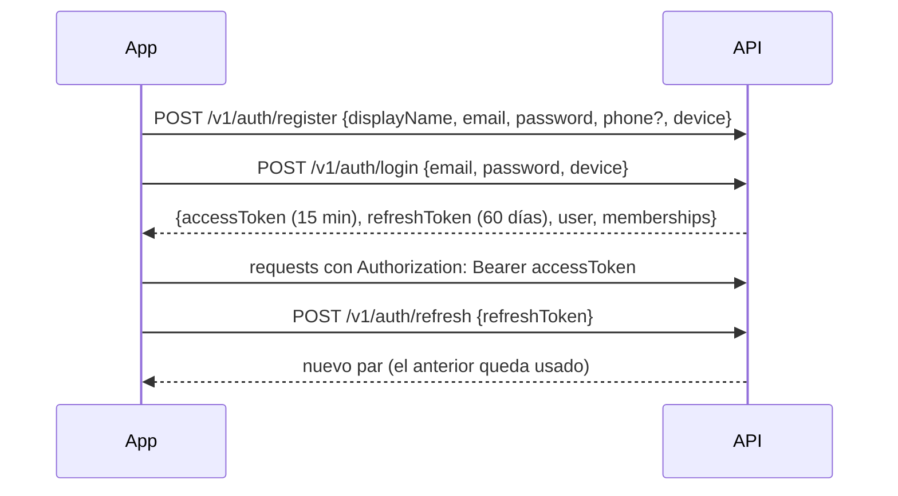

# Arquitectura del backend

Repositorio: `cumavi-shop-backend` (se reconstruye en la fase B0 tomando piezas
de `lacase-backend`, ver [reutilizacion-lacase.md](reutilizacion-lacase.md)).

## 1. Stack

| Pieza | Elección | Nota |
|---|---|---|
| Framework | NestJS 11 sobre **Fastify** | Igual que LaCase |
| Base de datos | PostgreSQL 16 | `timestamptz`, `citext`, índices parciales |
| ORM | TypeORM 0.3 + `typeorm-transactional` | `@Transactional()` en servicios |
| Migraciones | TypeORM migrations, `synchronize: false` | Una migración inicial nueva; nada de las de LaCase |
| Validación | `class-validator` + `ValidationPipe` global (`whitelist`, `forbidNonWhitelisted`, `transform`) | |
| Config | `joi` sobre `process.env` (`src/config/envs.config.ts`) | |
| Auth | Correo + contraseña propios (scrypt de `node:crypto`) + JWT propio (`@nestjs/jwt`) | Sin proveedores de identidad de terceros. Ver §3 |
| Cache / colas | Redis (Bull) | Cache de permisos, rate limit, notificaciones |
| Tiempo real | socket.io (`@nestjs/websockets`) | Bandeja de pedidos |
| Push | Firebase Cloud Messaging | Único uso de Firebase (B7) |
| Archivos | Disco local detrás de `StorageProvider` | R2/S3 después |
| Logs | `nestjs-pino` + correlation id | |
| Rate limit | `@nestjs/throttler` | Estricto en `/auth` y `/public` |
| Docs de API | `@nestjs/swagger` en `/docs` (solo dev/staging) | Nuevo respecto a LaCase |
| Tests | Jest: unit para helpers puros, integración con Postgres para invariantes | Nuevo respecto a LaCase |

## 2. Estructura y convenciones

```
src/
  main.ts  app.module.ts
  config/                 envs.config.ts
  common/                 response/, http-exception/, decorators/, dtos/, interceptors/,
                          tenancy/ (TenantContext, guards, decorators), idempotency/,
                          sequences/ (DocumentSequenceService), money/ (helpers en centavos)
  database/               datasource.config.ts, migrations/, seeders/
  auth/                   registro, login, contraseñas, JWT, refresh
  platform/               superadmin
  business/               businesses/, branches/, cash-registers/, settings/
  team/                   memberships/, invitations/, roles/, permissions/
  catalog/                categories/, products/, variants/, codes/, images/, pricing/
  inventory/              stock/, movements/, transfers/, counts/ (B10)
  payments/               payment-methods/
  cash/                   sessions/, movements/
  sales/                  sales/, returns/, summaries/
  customers/
  purchases/              suppliers/, purchase-orders/, receipts/, payments/
  ecommerce/              online-store/, public/, orders/
  files/  notifications/  websocket/  firebase/  logging/
```

Convenciones (heredadas de LaCase, con ajustes):

- Un `*.module.ts` por dominio; subcarpetas por feature con
  `controllers/`, `services/`, `dtos/` (con `index.ts`).
- Archivos en kebab-case; tablas en plural snake_case; columnas snake_case.
- **PK `uuid`.** Para escrituras que pueden venir offline (ventas, movimientos,
  sesiones de caja, pedidos), **el cliente genera el id** (UUID v7) y el
  servidor lo acepta si no existe.
- **`timestamptz` siempre** (LaCase usa `timestamp` sin zona y tiene que
  compensarlo). "Hoy" se calcula con `AT TIME ZONE businesses.timezone`.
- **Dinero `numeric(12,2)`.** TypeORM lo devuelve como string: los cálculos se
  hacen en centavos enteros dentro de helpers puros (`common/money`).
- **Cantidades `integer`** en v1.
- Enums como `text` + `CHECK` (más fáciles de migrar que los enums de Postgres).
- Soft delete (`deleted_at`) solo donde el historial apunta a la fila
  (productos, variantes, sucursales, métodos de pago, proveedores, clientes).
- **La API responde DTOs en camelCase, nunca entidades.** Así se respetan los
  contratos de la app y la web (`productId`, `variantId`) y se filtran campos
  sensibles (costo).
- Prefijo global `/v1`.

## 3. Autenticación



- **Sin terceros:** el login es con correo y contraseña propios del backend;
  no hay Firebase Auth, SMS ni Google. Firebase solo se usa para push (B7).
- El **correo** identifica la cuenta (único, en minúsculas). El celular es un
  dato de contacto.
- Contraseñas con **scrypt** de `node:crypto` (`PasswordService`, sin
  dependencias nativas): `scrypt$N=16384,r=8,p=1$<salt>$<hash>`. Política:
  8–128 caracteres con letras y números (`passwordTooShort`, `weakPassword`).
- Correo inexistente y contraseña mala responden igual (`invalidCredentials`)
  y tardan lo mismo. **5 fallos seguidos bloquean la cuenta 15 minutos**
  (`accountLocked`, 423, `details.retryAfterSeconds`).
- **Recuperación sin correos:** el superadmin (al dueño) o el dueño (a su
  personal, B8) generan una **contraseña temporal**; el usuario entra con ella
  y la app le pide cambiarla (`user.mustChangePassword`).
- **Cambiar o resetear la contraseña** revoca todos los refresh tokens del
  usuario y los access tokens emitidos antes (el guard compara `iat` con
  `users.password_changed_at`). `PUT /me/password` devuelve una sesión nueva
  para el dispositivo que hizo el cambio.
- **Access token**: JWT HS256, 15 minutos, payload `{sub: userId, sid:
  familyId}`. Solo identidad: no lleva negocio ni permisos.
- **Refresh token**: opaco (32 bytes aleatorios), se guarda solo su sha256 en
  `refresh_tokens`. **Rotación**: cada uso emite uno nuevo y marca el anterior
  como usado. **Si llega un token ya usado, se revoca toda la familia** (robo
  probable) y el usuario debe volver a entrar.
- `POST /auth/sign-out` revoca la familia y desactiva el dispositivo.
- Se reutiliza el patrón de LaCase `auth_sso_codes` (hash del token, reloj de la
  BD, consumo atómico con un único `UPDATE … WHERE used_at IS NULL`).

## 4. Multi-negocio (tenancy) y permisos

El negocio y la sucursal activos **viajan en headers**, no en el token:

| Header | Uso |
|---|---|
| `Authorization: Bearer …` | Identidad |
| `x-business-id` | Negocio activo (obligatorio en rutas de negocio) |
| `x-branch-id` | Sucursal activa (obligatorio en rutas de sucursal) |
| `Idempotency-Key` | Escrituras (ver §6) |

Ventajas: cambiar de sucursal es instantáneo, un mismo token sirve para un
usuario que trabaja en dos negocios y un cambio de permisos aplica sin esperar
a que venza el token.

Cadena de guards (globales; cada uno se salta con decoradores):

1. `ThrottlerGuard`.
2. `JwtAuthGuard`: todo es privado salvo `@Public()`. Carga el usuario y
   verifica `users.is_active`.
3. `TenantGuard` (rutas `@BusinessScoped()`): lee `x-business-id`, carga la
   membresía activa con permisos del rol y sucursales permitidas, y el estado
   del negocio. Errores: `businessNotFound` (404), `notAMember` (403),
   `businessSuspended` (403). Construye
   `TenantContext {businessId, userId, membershipId, isOwner, permissions, branchIds | 'all'}`.
   Cache por `(userId, businessId)` con TTL de 60 s en Redis; se invalida con los
   eventos `membership.updated` y `role.updated`.
4. `BranchGuard` (rutas `@BranchScoped()`): `x-branch-id` debe existir,
   pertenecer al negocio, estar activa y estar en las sucursales permitidas.
   Errores: `branchRequired`, `branchForbidden`. Si una ruta recibe otra
   sucursal en el body (destino de transferencia), el servicio llama a
   `ctx.assertBranch(id)`.
5. `PermissionGuard`: `@RequirePermission('sale.cancel')` o
   `@RequireAnyPermission(...)`. El dueño pasa siempre. Error
   `permissionDenied` (403) con `details.permission`.
6. `/v1/admin/*`: guards de superadmin de LaCase.

Reglas de datos:

- Los servicios reciben `ctx` explícito (`@Ctx() ctx: TenantContext`) y **toda
  consulta filtra `business_id`** (y `branch_id` cuando corresponde).
- Ids de otras entidades que llegan en el body (categoría, variante, método de
  pago, proveedor, cliente) se validan con un helper `findOwned(ctx, repo, ids)`
  que lanza `xxxNotFound` si alguno no es del negocio.
- Campos sensibles (costo, margen) solo salen si el usuario tiene
  `product.view_cost`. La API pública usa DTOs propios que nunca los incluyen.
- RLS de Postgres queda como defensa adicional posterior.

## 5. Formato de respuesta y errores

Éxito (se reutiliza el `ResponseInterceptor` de LaCase):

```json
{ "ok": true, "statusCode": 200, "message": "OK", "data": { } }
```

Listas paginadas: `data = { items, total, page, limit }`. Los historiales
grandes (movimientos, ventas) también aceptan `cursor`.

Error (se extiende el `HttpExceptionFilter` de LaCase con `code` y `details`):

```json
{ "ok": false, "statusCode": 409, "code": "productCodeTaken",
  "message": "El código ya está en uso", "details": { "code": "7771234567890" },
  "path": "/v1/products" }
```

- `code` usa **los mismos nombres que el enum `FailureCode`** de la app
  (`apps/mobile/lib/core/error/failure_code.dart`), así la app traduce el error
  sin mapas adicionales.
- HTTP: validación 422, no encontrado 404, conflicto/regla de negocio 409,
  permisos 403, sesión 401.
- Errores de Postgres: `23505` (único) se traduce por nombre de constraint
  (`UQ_product_codes_business_code` → `productCodeTaken`,
  `UQ_categories_business_name` → `categoryNameTaken`); `23514` (check) en
  `branch_stock` → `insufficientStock`.
- Errores de `class-validator` → `validationFailed` con `details.fields`.

### Códigos nuevos (no existen aún en la app)

| Código | HTTP | Cuándo |
|---|---|---|
| `validationFailed` | 422 | DTO inválido |
| `unauthenticated` / `refreshTokenInvalid` / `refreshTokenReused` / `userInactive` | 401 | Sesión |
| `invalidCredentials` / `accountLocked` / `currentPasswordInvalid` | 401 / 423 / 422 | Login y cambio de contraseña |
| `emailTaken` / `weakPassword` | 409 / 422 | Registro (`passwordTooShort` ya existe en la app) |
| `notFound`, `conflict`, `tooManyRequests` | 404 / 409 / 429 | Genéricos (ruta inexistente, constraint sin código propio, rate limit) |
| `notAMember`, `businessSuspended`, `branchRequired`, `branchForbidden`, `permissionDenied` | 403 | Tenancy y permisos |
| `businessNotFound`, `branchNotFound`, `variantNotFound`, `paymentMethodNotFound`, `customerNotFound`, `supplierNotFound`, `purchaseOrderNotFound`, `orderNotFound`, `cashRegisterNotFound` | 404 | |
| `businessAlreadyRegistered`, `branchCodeTaken`, `invalidOpeningHours` | 409 / 409 / 422 | Negocio y sucursales |
| `slugTaken`, `branchNameTaken`, `cashRegisterNameTaken`, `paymentMethodNameTaken`, `customerPhoneTaken`, `supplierNameTaken` | 409 | Únicos |
| `idempotencyKeyReused`, `requestInProgress` | 422 / 409 | §6 |
| `priceChanged` | 409 | El precio enviado por el cliente ya no es el vigente |
| `paymentsMismatch` | 422 | Σ pagos ≠ total |
| `changeOnNonCash` | 422 | Cambio en un pago que no es efectivo |
| `cashSessionHasPendingWork`, `cashRegisterInactive`, `insufficientCash` | 409 | Caja |
| `paymentReferenceRequired` | 422 | Método de pago que exige referencia |
| `roleInUse`, `roleNameTaken`, `systemRoleCannotBeDeleted` | 409 | Roles |
| `fileNotFound` / `fileTooLarge` / `unsupportedFileType` | 404 / 413 / 415 | Archivos |
| `invalidOrderTransition`, `storeClosed`, `storeDisabled` | 409 | Pedidos |
| `invalidPurchaseTransition`, `receiveQuantityExceeded`, `paymentExceedsDue` | 409 | Compras |
| `transferSameBranch`, `invalidTransferTransition` | 409 | Transferencias |
| `lastOwnerCannotLeave`, `invitationExpired` | 409 | Equipo |
| `defaultBranchRequired`, `lastActiveBranch` | 409 | Sucursales |

La app agrega estos valores a `FailureCode` en la feature F17.

## 6. Idempotencia

Dos capas:

1. **UUID del cliente como PK** en ventas, devoluciones, movimientos de stock,
   sesiones y movimientos de caja, pedidos, recepciones y pagos de compras. Si
   el id ya existe y pertenece al mismo negocio, se devuelve el recurso
   existente (200) en lugar de crear otro. Es la garantía que sobrevive a la
   limpieza de la tabla de claves.
2. **Header `Idempotency-Key`** en todo `POST` que escriba. Tabla
   `idempotency_keys (user_id, key, method, path, request_hash, status,
   response_status, response_body, expires_at 72 h)`. Se resuelve con un helper
   `withIdempotency()` dentro del mismo `@Transactional`, para que la escritura y
   la respuesta guardada se confirmen juntas.
   - Misma clave y mismo body → misma respuesta.
   - Misma clave con body distinto → 422 `idempotencyKeyReused`.
   - Clave todavía en proceso → 409 `requestInProgress`.

Esto permite agregar una cola offline en la app sin cambiar la API.

## 7. Numeración de documentos

Tabla `document_sequences (business_id, doc_type, scope_id, next_value)`.
Un solo `INSERT … ON CONFLICT DO UPDATE … RETURNING` dentro de la transacción
del documento: no hay huecos ni números repetidos (LaCase usa `MAX()+1`, que
puede repetir números con dos peticiones simultáneas).

| Documento | Alcance | Empieza | Formato |
|---|---|---|---|
| Venta | Sucursal | 1 | `#0019` (con código de sucursal si hay 2+: `C1-0019`) |
| Devolución | Sucursal | 1 | `D-0001` |
| Pedido web | Negocio | 1001 | `#1001` |
| Orden de compra | Negocio | 1 | `OC-0001` |
| Transferencia | Negocio | 1 | `TR-0001` |
| Conteo de inventario | Negocio | 1 | `CI-0001` |

La venta se numera por sucursal porque la facturación SIN se organiza por
sucursal y punto de venta, y así cada sucursal no espera el bloqueo de las
demás.

## 8. Stock: única vía de escritura

`StockService.apply(ctx, lines[])` es la **única** forma de cambiar stock
(ventas, devoluciones, compras, ajustes, transferencias):

1. Ordena las líneas por `variant_id` (evita deadlocks).
2. Por línea: `INSERT INTO branch_stock … ON CONFLICT DO NOTHING` (fila
   perezosa) y luego
   `UPDATE branch_stock SET quantity = quantity + $delta WHERE branch_id = $b AND variant_id = $v AND quantity + $delta >= 0 RETURNING quantity`.
3. Si no devuelve fila → `insufficientStock` con `details` de la variante.
4. Inserta el movimiento en `stock_movements` con `stock_after` del
   `RETURNING`, en la misma transacción.

## 9. Archivos

Interfaz `StorageProvider { put, delete, publicUrl }` con `LocalStorageProvider`
(reutiliza `FilesService` de LaCase: `public/uploads/<carpeta>/<uuid>.<ext>`)
y, después, `S3StorageProvider` (Cloudflare R2). La tabla `files` guarda
proveedor, `storage_key`, tipo MIME, tamaño, dimensiones y propósito; las
entidades referencian `file_id`. Migrar a R2 solo cambia el proveedor de los
archivos nuevos. Detalle en
[modulos/archivos-y-notificaciones.md](modulos/archivos-y-notificaciones.md).

## 10. Tiempo real y push

- Gateway socket.io en `/v1/ws`. Handshake `{token, businessId}`; el servidor
  une el socket a las salas `user:{id}`, `business:{id}` y `branch:{id}` (solo
  las sucursales permitidas).
- Eventos v1: `order.created`, `order.updated`, `notification.created`.
- Push FCM para pedidos nuevos cuando la app está en segundo plano.
- Al cambiar la membresía de un usuario se desconectan sus sockets.

## 11. API pública (catálogo web)

- Rutas `@Public()` bajo `/v1/public/…`, rate limit por IP (y por celular en
  `POST /orders`).
- Solo negocios `status = active` con tienda en línea habilitada.
- DTOs propios: nunca costo, stock de otras sucursales, datos de empleados ni
  ventas.
- Cache HTTP corto (`Cache-Control: s-maxage=60`) para catálogo y producto.

## 12. Entornos y despliegue

- `docker-compose.yml` con API, Postgres y Redis (nombres `cumavi-*`).
- Variables nuevas: `SUPERADMIN_EMAIL`, `SUPERADMIN_PASSWORD` (seeder),
  `FIREBASE_CREDENTIALS_PATH` (solo push),
  `JWT_ACCESS_TTL`, `JWT_REFRESH_TTL_DAYS`, `STORAGE_DRIVER`,
  `PUBLIC_BASE_URL`, `CORS_ORIGINS`, `DEFAULT_TIMEZONE`.
- `google-services.json` y credenciales **fuera del repositorio**.
- Swagger solo fuera de producción.
