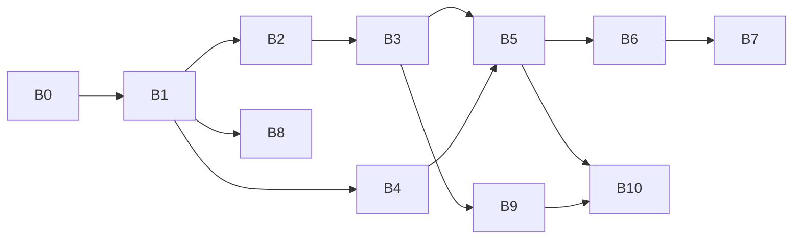

# Roadmap del backend

Plan para construir `cumavi-shop-backend` y conectar la app POS y el catálogo
web. Estado: **Planificado** · **En curso** · **Hecho**.

Última actualización: 2026-10-05.

## Reglas

- Cada fase deja una API usable de punta a punta, con migración, seeders,
  tests de los invariantes de la fase y Swagger actualizado.
- La app conecta cada módulo apenas está listo (flavor `api`), sin esperar al
  resto; el flavor `mock` sigue funcionando para demos.
- Los contratos de [roadmap.md](roadmap.md) (F2–F6) se respetan; los cambios
  están listados en F23.
- Tamaños: S ≈ 2–3 días, M ≈ 1 semana, L ≈ 2 semanas (una persona).

## Resumen

| Fase | Contenido | Tamaño | App POS | Web | Features móviles | Estado |
|---|---|---|---|---|---|---|
| B0 | Limpieza y fundación | M | — | — | — | Planificado |
| B1 | Identidad, negocio, sucursales, equipo base | L | F17, F18, F19 | — | F1 | Planificado |
| B2 | Catálogo | L | F20, F23 | — | F2, F6, F7 | Planificado |
| B3 | Inventario | M/L | F20, F24 | — | F3 | Planificado |
| B4 | Caja y métodos de pago | M | F21, F22 | — | — | Planificado |
| B5 | Ventas | L | F20, F21, F23 | — | F4, F5 | Planificado |
| B6 | Clientes | S | F9 | — | F9 | Planificado |
| B7 | Ecommerce y pedidos | L | F11, F12, F26 | API, sin exportación estática | F11, F12, F13 | Planificado |
| B8 | Equipo y roles | M | F14 | — | F14 | Planificado |
| B9 | Compras | L | F25 | — | — | Planificado |
| B10 | Reportes y alertas | M/L | F15, F16 | — | F15, F16 | Planificado |
| B11 | Posterior | — | F8, F10 | marketplace | F8, F10 | — |

Hito **MVP para piloto** = B0–B5 (un negocio vende con varias sucursales y
cajas). Hito **catálogo en línea** = + B6–B7. Hito **gestión completa** = +
B8–B10.

---

## B0 · Limpieza y fundación — M

**Objetivo:** un proyecto limpio de Cumavi que compila, arranca y tiene la base
común.

- `git init` con remote nuevo; `package.json` → `cumavi-shop-backend`; docker
  `cumavi-api`, `cumavi-postgres`, `cumavi-redis`; `.env.template` corregido.
- Borrar `src/store`, `src/profile`, `dist/`, todas las migraciones y los
  seeders viejos. Sacar `google-services.json`.
- Copiar desde LaCase HEAD la base común ([reutilización](reutilizacion-lacase.md)).
- Prefijo `/v1`, CORS, Swagger, throttler, guard JWT global con `@Public`.
- Filtro de errores con `code` y mapeo de errores de Postgres.
- `TenantContext` + decoradores `@BusinessScoped`, `@BranchScoped`,
  `@RequirePermission`, `@Ctx` (guards vacíos hasta B1).
- `DocumentSequenceService`, helper `withIdempotency` + tabla
  `idempotency_keys`, helpers de dinero en centavos.
- `StorageProvider` + `LocalStorageProvider` + tabla `files`.
- Health check (`/v1/health`), logging pino.
- Migración inicial con las tablas de plataforma.
- Jest configurado con base de datos de prueba (docker).

**Listo cuando:** `npm run build` y `npm run test` pasan; `docker compose up`
levanta API, Postgres y Redis; `/v1/health` responde; Swagger en `/docs`.

## B1 · Identidad, negocio, sucursales y equipo base — L

- Firebase Admin `verifyIdToken`; `POST /auth/firebase`, `/auth/refresh`
  (rotación + detección de reuso), `/auth/sign-out`; `/me`,
  `/me/memberships`; dispositivos.
- `POST /businesses` (registro transaccional), `GET/PATCH /business`,
  `business_settings`.
- Sucursales (CRUD, horarios, principal) y cajas.
- Catálogo de permisos y 4 plantillas de rol (seeders); membresía del dueño;
  `TenantGuard`, `BranchGuard` y `PermissionGuard` funcionando.
- Superadmin: listar, suspender y reactivar negocios.
- Seeder demo: "Illimani Store" con 2 sucursales, cajas y usuarios de cada rol.

**Docs:** [auth y negocio](modulos/auth-y-negocio.md),
[sucursales](modulos/sucursales.md), [roles](modulos/roles.md),
[plataforma](modulos/plataforma.md).
**Listo cuando:** la app (F18) se registra con SMS real, crea el negocio y
elige sucursal y caja; un usuario sin permiso recibe 403.

## B2 · Catálogo — L

- Categorías (contrato F2).
- Productos con opciones, valores, variantes, variante por defecto, códigos
  (lookup, sugerencia de SKU), fotos (subida, orden, miniaturas).
- `PricingService`, precio por variante (F7) y por sucursal.
- Búsqueda paginada (nombre, categoría, valor de variante, código); bajo stock.
- Seeder demo desde `packages/mock-catalog/catalog.json`.

**Docs:** [categorías](modulos/categorias.md), [productos](modulos/productos.md).
**Listo cuando:** la app (F20) crea y edita productos contra la API, escanea
códigos y ve los precios de su sucursal.

## B3 · Inventario — M/L

- `branch_stock`, `StockService`, `POST /stock-movements`, historial,
  `variant_removed`.
- Stock inicial al crear productos.
- Stock de otras sucursales.
- Transferencias (borrador, enviar, recibir, cancelar).

**Docs:** [inventario](modulos/inventario.md).
**Listo cuando:** pasan los tests de concurrencia de stock (nunca < 0); la app
registra ingresos y ajustes y hace transferencias (F24).

## B4 · Caja y métodos de pago — M

- Métodos de pago (CRUD, orden, QR).
- Sesiones por caja: abrir, resumen, movimientos de entrada y salida con foto,
  cerrar con esperado, diferencia y snapshot; historial.

**Docs:** [métodos de pago](modulos/metodos-de-pago.md), [caja](modulos/caja.md).
**Listo cuando:** la app abre y cierra caja contra la API, registra entradas y
salidas, y el cierre ciego funciona (F22).

## B5 · Ventas — L

- `POST /sales` con pago dividido, precios del servidor, prorrateo, `unit_cost`,
  numeración por sucursal; `quote`.
- Historial, detalle, comprobante.
- Anular y devolver (reglas de F5).
- Resumen diario para Inicio.

**Docs:** [ventas](modulos/ventas.md).
**Listo cuando:** pasan los tests de Σ pagos = total, prorrateo, anulación con
la sesión cerrada y devoluciones acumuladas; la app vende con pago dividido
(F21) y el cierre de caja cuadra.

**Hito MVP para piloto.**

## B6 · Clientes — S

- CRUD, búsqueda, deduplicación por celular, totales, historial; cliente en la
  venta.

**Docs:** [clientes](modulos/clientes.md).

## B7 · Ecommerce y pedidos — L

- Configuración de la tienda en línea; flags de sucursal; `show_online`.
- API pública (tienda, productos, pedido, estado).
- Bandeja de pedidos, estados, edición, cobro (crea la venta).
- Websocket y push de pedidos nuevos.
- **Web:** repositorios HTTP, quitar `output: 'export'`, selector de sucursal,
  manejo de `priceChanged` e `insufficientStock`, página de estado del pedido.

**Docs:** [ecommerce](modulos/ecommerce.md),
[archivos y notificaciones](modulos/archivos-y-notificaciones.md).
**Listo cuando:** un pedido hecho en la web aparece en la bandeja del POS en
menos de 2 s y se cobra como venta.

## B8 · Equipo y roles — M

- Invitaciones por celular, aceptar, editar rol y sucursales, suspender,
  quitar.
- CRUD de roles.
- PIN de cambio rápido.
- Auditoría de acciones sensibles.

**Docs:** [usuarios](modulos/usuarios.md), [roles](modulos/roles.md).

## B9 · Compras — L

- Proveedores; órdenes de compra; recepciones parciales; pagos (incluido
  "desde caja"); actualización de costo; cuentas por pagar.

**Docs:** [compras](modulos/compras.md).

## B10 · Reportes y alertas — M/L

- Reportes de ventas, margen, cierres, inventario, cuentas por pagar; CSV y
  Excel.
- Stock mínimo, alertas y lista de reposición.
- Conteos de inventario con documento.

**Docs:** [reportes](modulos/reportes.md).

## B11 · Posterior

- Planes, límites y suscripción del SaaS.
- Promociones (F8; base: motor de promociones de LaCase).
- Fiado (F10).
- Sincronización offline (`POST /v1/sync/batch` usando la idempotencia).
- Almacenamiento R2/S3 y CDN.
- Facturación electrónica SIN.
- Marketplace social: búsqueda entre negocios, seguir, chat, compartir
  productos, carrito del consumidor.

---

## Cambios que la app POS necesita (resumen)

Detalle en [roadmap.md](roadmap.md), fase 5.

| Feature | Qué cambia | Fase backend |
|---|---|---|
| F17 | Cliente HTTP (dio), tokens, headers `x-business-id`/`x-branch-id`, `code` → `FailureCode`, UUID + `Idempotency-Key`, flavors mock/api | B0–B1 |
| F18 | Firebase Auth real; registro contra la API | B1 |
| F19 | Selector de negocio, sucursal y caja | B1, B4 |
| F20 | Repositorios mock → API, módulo por módulo | B2–B5 |
| F21 | Métodos de pago como entidad; pago dividido | B4–B5 |
| F22 | Varias cajas; entradas y salidas; cierre ciego | B4 |
| F23 | Ajustes de contrato: `saleLineId`, `cashSessionId`, `unitCost`, uuid de variante, variante por defecto | B2–B5 |
| F24 | Stock por sucursal y transferencias | B3 |
| F25 | Compras | B9 |
| F26 | Push, socket y bandeja de pedidos | B7 |

## Cambios que la web necesita (B7)

- `catalogRepository()` y `orderRepository()` → HTTP.
- Quitar la exportación estática; ISR o SSR.
- Horario y dirección por sucursal; selector de sucursal de retiro.
- Métodos de pago con datos o QR.
- Variantes con precio e id uuid.
- Manejo de `priceChanged` e `insufficientStock`.
- Confirmación con `publicToken` y estado en vivo.
