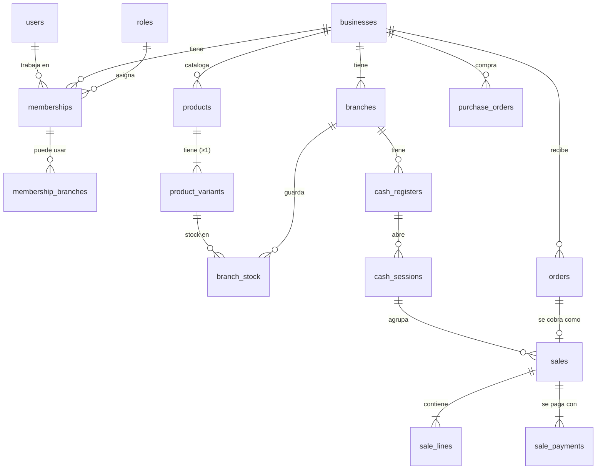

# Modelo de datos

PostgreSQL. Convenciones (ver [arquitectura-backend.md](arquitectura-backend.md)):

- Todas las tablas: `id uuid` PK, `created_at` y `updated_at` `timestamptz`
  (se omiten abajo).
- Dinero `numeric(12,2)`; cantidades `integer`; enums `text` + `CHECK`.
- `business_id` en toda tabla de un negocio; `branch_id` en las de sucursal.
- **(cid)** = el cliente puede enviar el `id` (UUID v7) para idempotencia.
- `snap` = copia del valor al momento (snapshot) para que el historial no cambie.

## Mapa general

---

## 1. Plataforma e identidad

| Tabla | Columnas clave | Restricciones |
|---|---|---|
| `users` | `display_name`, `phone_e164` null, `email citext` null, `avatar_file_id` null, `is_active`, `last_login_at`, `deleted_at` | UNIQUE(`phone_e164`) WHERE NOT NULL; UNIQUE(`email`) WHERE NOT NULL. Sin contraseña. |
| `auth_identities` | `user_id`, `provider` (`firebase`), `subject` (uid de Firebase), `sign_in_methods text[]` (phone, google.com, password), `phone`, `email`, `last_used_at` | UNIQUE(`provider`, `subject`) |
| `refresh_tokens` | `user_id`, `family_id`, `token_hash char(64)`, `parent_id`, `device_id` null, `expires_at`, `used_at`, `revoked_at`, `revoked_reason`, `ip`, `user_agent` | UNIQUE(`token_hash`); INDEX(`family_id`) |
| `user_devices` | `user_id`, `installation_id`, `platform` (android/ios/web), `fcm_token`, `app_version`, `last_seen_at`, `is_active` | UNIQUE(`user_id`, `installation_id`) |
| `super_admins` | `user_id`, `role_id`, `is_active` | UNIQUE(`user_id`). Tablas `super_admin_roles`, `super_admin_permissions`, `super_admin_role_permissions` como en LaCase. |
| `audit_logs` | `business_id` null, `user_id`, `action` (`sale.cancel`), `entity`, `entity_id`, `data jsonb`, `ip` | INDEX(`business_id`, `created_at`) |
| `idempotency_keys` | `user_id`, `key`, `method`, `path`, `request_hash`, `status` (in_progress/completed), `response_status`, `response_body jsonb`, `resource_id`, `expires_at` | PK(`user_id`, `key`) |

## 2. Negocio, sucursales y equipo

| Tabla | Columnas clave | Restricciones |
|---|---|---|
| `businesses` | `slug citext`, `name`, `type` (clothing_and_footwear, neighborhood_store, food_and_drinks, beauty_and_care, technology, hardware, pets, other), `department` (9 de Bolivia), `city`, `logo_file_id`, `nit varchar(15)` null, `owner_user_id`, `status` (active/suspended/closed), `suspended_reason`, `timezone` (`America/La_Paz`), `currency` (`BOB`) | UNIQUE(`slug`); CHECK slug `^[a-z0-9](-?[a-z0-9]){2,39}$`; CHECK nit `^\d{5,15}$` |
| `business_settings` (1:1) | `business_id` PK, `cost_update_mode` (last/average/manual), `return_window_days` (30), `low_stock_threshold` (5), `allow_sale_without_session` (false) | |
| `branches` | `business_id`, `name`, `code` (corto, ej. `C1`), `department`, `city`, `zone`, `address`, `lat`, `lng`, `phone`, `whatsapp`, `is_active`, `is_default`, `sells_online`, `pickup_enabled`, `delivery_enabled`, `deleted_at` | UNIQUE(`business_id`, lower(`name`)); UNIQUE(`business_id`, `code`); UNIQUE(`business_id`) WHERE `is_default` |
| `branch_opening_hours` | `branch_id`, `weekday` (1–7, ISO), `opens time`, `closes time` | UNIQUE(`branch_id`, `weekday`, `opens`); CHECK `closes > opens` |
| `cash_registers` | `business_id`, `branch_id`, `name` ("Caja 1"), `is_active`, `deleted_at` | UNIQUE(`branch_id`, lower(`name`)) |
| `roles` | `business_id`, `template_key` null (admin/branch_manager/cashier/stock), `name`, `description`, `is_system` | UNIQUE(`business_id`, lower(`name`)) |
| `permissions` | `key` (`sale.cancel`), `module`, `scope` (business/branch), `description`, `is_sensitive` | UNIQUE(`key`). Catálogo global sembrado. |
| `role_permissions` | `role_id`, `permission_id` | PK(`role_id`, `permission_id`) |
| `memberships` | `business_id`, `user_id`, `role_id`, `is_owner`, `all_branches`, `status` (active/suspended/removed), `pin_hash` null, `joined_at`, `invited_by` | UNIQUE(`business_id`, `user_id`); UNIQUE(`business_id`) WHERE `is_owner` |
| `membership_branches` | `membership_id`, `branch_id` | PK(ambos). Se ignora si `all_branches`. |
| `membership_invitations` | `business_id`, `phone_e164`, `role_id`, `all_branches`, `branch_ids uuid[]`, `invited_by`, `expires_at`, `accepted_at`, `revoked_at` | UNIQUE(`business_id`, `phone_e164`) WHERE pendiente |

## 3. Catálogo

**Todo producto tiene al menos una variante.** Un producto simple tiene una
variante oculta con `is_default = true` y `key = 'default'`. Así stock, ventas,
pedidos, compras y transferencias siempre apuntan a `variant_id NOT NULL`, y el
precio por variante, el costo y la imagen viven en un solo lugar. La API oculta
la variante por defecto: un producto con `hasVariants = false` no muestra
`variantId`, y una petición sin `variantId` usa la variante por defecto.

| Tabla | Columnas clave | Restricciones |
|---|---|---|
| `categories` | `business_id`, `name`, `name_normalized` (minúsculas, sin tildes), `sort_order`, `is_archived` | UNIQUE(`business_id`, `name_normalized`); CHECK largo 2–30 |
| `products` | `business_id`, `category_id` NOT NULL, `name`, `slug`, `description`, `base_price`, `default_cost`, `has_variants`, `is_active`, `show_online`, `deleted_at` | UNIQUE(`business_id`, `slug`); INDEX(`business_id`, `category_id`); índice trigram en `name` para búsqueda |
| `product_options` | `product_id`, `name` (Color), `position` | UNIQUE(`product_id`, lower(`name`)); UNIQUE(`product_id`, `position`) |
| `product_option_values` | `option_id`, `value` (Rojo), `position` | UNIQUE(`option_id`, lower(`value`)) |
| `product_variants` | `business_id`, `product_id`, `key` (`rojo/40` o `default`), `label` (`Rojo · 40`), `is_default`, `price` null (sobrescribe `base_price`), `cost`, `image_id` null, `position`, `is_active`, `deleted_at` | UNIQUE(`product_id`, `key`) WHERE no borrada; UNIQUE(`product_id`) WHERE `is_default` y no borrada |
| `product_variant_values` | `variant_id`, `option_id`, `option_value_id` | PK(`variant_id`, `option_id`) |
| `product_codes` | `business_id`, `code` (mayúsculas, sin espacios), `kind` (sku/barcode), `product_id`, `variant_id` null | **UNIQUE(`business_id`, `code`)**: SKU y código de barras comparten espacio de nombres en todo el negocio. UNIQUE(`product_id`, `kind`) WHERE `variant_id` IS NULL; UNIQUE(`variant_id`, `kind`) WHERE NOT NULL; CHECK formato por tipo |
| `product_images` | `product_id`, `file_id`, `position` (0 = principal) | UNIQUE(`product_id`, `position`) DEFERRABLE |
| `branch_price_overrides` | `business_id`, `branch_id`, `product_id`, `variant_id` null, `price` | UNIQUE(`branch_id`, `product_id`) WHERE `variant_id` IS NULL; UNIQUE(`branch_id`, `variant_id`) WHERE NOT NULL |

**Precio vigente** (`PricingService.resolve(branchId, variantId)`), en orden:
precio de sucursal para la variante → precio de sucursal para el producto →
`product_variants.price` → `products.base_price`.

**Costo**: por variante y único para todo el negocio. `products.default_cost`
inicializa las variantes nuevas. Las compras lo actualizan según
`business_settings.cost_update_mode`.

## 4. Stock

| Tabla | Columnas clave | Restricciones |
|---|---|---|
| `branch_stock` | `business_id`, `branch_id`, `variant_id`, `quantity int`, `min_stock` null | PK(`branch_id`, `variant_id`); **CHECK(`quantity >= 0`)** |
| `stock_batches` | `business_id`, `branch_id`, `kind` (receipt/adjustment), `supplier_id` null, `supplier_name`, `note`, `user_id` | Agrupa un "Ingreso de mercadería" de varias líneas |
| `stock_movements` (cid) | `business_id`, `branch_id`, `product_id`, `variant_id`, `batch_id` null, `delta int` ≠ 0, `stock_after int`, `type` (initial/purchase/adjustment/sale/cancellation/return/transfer_out/transfer_in), `reason` null (count/damage/loss/other/variant_removed), `note`, `unit_cost` null, `source_type` (sale/sale_return/purchase_receipt/transfer/inventory_count/batch/product), `source_id`, `product_name` snap, `variant_label` snap, `user_id` | Solo inserción. INDEX(`business_id`, `branch_id`, `created_at` DESC); INDEX(`variant_id`, `created_at` DESC); INDEX(`source_type`, `source_id`) |
| `stock_transfers` | `business_id`, `number`, `from_branch_id`, `to_branch_id`, `status` (draft/sent/received/cancelled), `note`, `created_by`, `sent_at`, `sent_by`, `received_at`, `received_by` | UNIQUE(`business_id`, `number`); CHECK `from <> to` |
| `stock_transfer_lines` | `transfer_id`, `variant_id`, `quantity_sent`, `quantity_received` null | UNIQUE(`transfer_id`, `variant_id`) |
| `inventory_counts` (B10) | `business_id`, `branch_id`, `number`, `status` (draft/applied/cancelled), `scope` (all/category/selection), `category_id`, `note`, `created_by`, `applied_at`, `applied_by` | UNIQUE(`business_id`, `number`) |
| `inventory_count_lines` (B10) | `count_id`, `variant_id`, `counted_qty`, `expected_qty`, `difference` | UNIQUE(`count_id`, `variant_id`) |

## 5. Numeración

| Tabla | Columnas clave | Restricciones |
|---|---|---|
| `document_sequences` | `business_id`, `doc_type` (sale/sale_return/order/purchase_order/transfer/inventory_count), `scope_id` (sucursal o negocio), `next_value bigint` | PK(`business_id`, `doc_type`, `scope_id`) |

## 6. Métodos de pago y caja

| Tabla | Columnas clave | Restricciones |
|---|---|---|
| `payment_methods` | `business_id`, `type` (cash/qr/card/bank_transfer/other), `name`, `is_cash`, `is_active`, `show_online`, `requires_reference`, `details` (texto para la web, ej. cuenta bancaria), `qr_file_id` null, `sort_order`, `deleted_at` | UNIQUE(`business_id`, lower(`name`)); CHECK(`is_cash = (type = 'cash')`) |
| `cash_sessions` (cid) | `business_id`, `branch_id`, `cash_register_id`, `status` (open/closed), `opened_by`, `opened_at`, `opening_amount`, `closed_by`, `closed_at`, `counted_amount`, `expected_amount`, `difference`, `closing_note`, `close_snapshot jsonb` | **UNIQUE(`cash_register_id`) WHERE `status = 'open'`**; CHECK `opening_amount >= 0` |
| `cash_movements` (cid) | `business_id`, `branch_id`, `session_id`, `type` (in/out), `amount` > 0, `reason` (change_fund/expense/withdrawal/supplier_payment/other), `description`, `photo_file_id` null, `source_type`/`source_id` null, `user_id` | INDEX(`session_id`) |

`close_snapshot` guarda los totales por método, cantidad de ventas,
devoluciones y entradas/salidas, para que el cierre no cambie si después se
corrige algo.

## 7. Ventas

| Tabla | Columnas clave | Restricciones |
|---|---|---|
| `sales` (cid) | `business_id`, `branch_id`, `cash_register_id`, `cash_session_id` NOT NULL, `number`, `channel` (pos/online_order), `order_id` null, `customer_id` null, `status` (completed/cancelled/partially_returned/returned), `subtotal`, `discount_amount`, `total`, `total_cost`, `amount_received`, `change_amount`, `note`, `cashier_user_id`, `cashier_name` snap, `sold_at` (reloj del dispositivo), `cancelled_at`, `cancelled_by`, `cancel_reason` | UNIQUE(`branch_id`, `number`); UNIQUE(`order_id`) WHERE NOT NULL; INDEX(`business_id`, `sold_at`); INDEX(`cash_session_id`) |
| `sale_lines` | `sale_id`, `position`, `product_id`, `variant_id`, `product_name` snap, `variant_label` snap, `unit_price`, `quantity`, `line_subtotal`, `discount_amount` (prorrateado), `line_total`, `unit_cost` snap, `returned_quantity` (0) | UNIQUE(`sale_id`, `position`); CHECK(`returned_quantity BETWEEN 0 AND quantity`) |
| `sale_payments` | `sale_id`, `payment_method_id`, `method_type` snap, `method_name` snap, `is_cash` snap, `amount`, `tendered` null, `change` null, `reference` | Σ `amount` = `sales.total`; `change` solo si `is_cash` |
| `sale_returns` (cid) | `business_id`, `branch_id`, `sale_id`, `number`, `cash_session_id` (sesión donde se devuelve), `refund_payment_method_id`, `refund_method_type` snap, `refund_is_cash` snap, `amount`, `reason`, `user_id` | UNIQUE(`branch_id`, `number`) |
| `sale_return_lines` | `return_id`, `sale_line_id`, `quantity`, `amount`, `restock` | UNIQUE(`return_id`, `sale_line_id`) |

## 8. Clientes

| Tabla | Columnas clave | Restricciones |
|---|---|---|
| `customers` | `business_id`, `name`, `phone_e164`, `email`, `doc_type` (ci/nit) null, `doc_number`, `invoice_name`, `address`, `note`, `user_id` null (enlace futuro al consumidor), `source` (pos/online_order), `deleted_at` | UNIQUE(`business_id`, `phone_e164`) WHERE NOT NULL y no borrado |

## 9. Compras

| Tabla | Columnas clave | Restricciones |
|---|---|---|
| `suppliers` | `business_id`, `name`, `nit`, `contact_name`, `phone`, `email`, `address`, `note`, `is_active`, `deleted_at` | UNIQUE(`business_id`, lower(`name`)) |
| `purchase_orders` | `business_id`, `branch_id` (destino), `supplier_id`, `number`, `status` (draft/confirmed/partially_received/received/cancelled), `payment_status` (unpaid/partial/paid), `order_date`, `expected_date`, `due_date`, `subtotal`, `discount_amount`, `tax_amount`, `total`, `paid_amount`, `note`, `created_by`, `confirmed_at`, `confirmed_by`, `cancelled_at`, `cancelled_by`, `cancel_reason` | UNIQUE(`business_id`, `number`) |
| `purchase_order_lines` | `purchase_order_id`, `product_id`, `variant_id`, `product_name` snap, `variant_label` snap, `quantity_ordered`, `quantity_received` (0), `unit_cost`, `discount_amount`, `line_total` | CHECK(`quantity_received <= quantity_ordered`) |
| `purchase_receipts` (cid) | `purchase_order_id`, `branch_id`, `received_by`, `received_at`, `note` | |
| `purchase_receipt_lines` | `receipt_id`, `order_line_id`, `quantity` > 0, `unit_cost` | Cada línea genera un movimiento `purchase` |
| `purchase_payments` (cid) | `business_id`, `purchase_order_id`, `payment_method_id`, `amount`, `paid_at`, `reference`, `note`, `user_id`, `cash_movement_id` null | Σ pagos ≤ `total` |

## 10. Ecommerce

| Tabla | Columnas clave | Restricciones |
|---|---|---|
| `online_stores` (1:1 negocio) | `business_id` PK, `is_enabled`, `tagline`, `banner_file_id`, `whatsapp`, `delivery_branch_id` (sucursal por defecto para envíos), `delivery_note`, `accept_outside_hours`, `show_out_of_stock` | |
| `orders` (cid) | `business_id`, `branch_id`, `number`, `status` (new/confirmed/ready/delivered/cancelled), `fulfillment` (pickup/delivery), `customer_name`, `customer_phone_e164`, `delivery_address`, `customer_note` (≤200), `payment_method_id`, `payment_method_name` snap, `subtotal`, `delivery_fee` (0), `total`, `customer_id` null, `user_id` null (consumidor, futuro), `sale_id` null, `public_token`, `source` (web/whatsapp_import), `ip_hash`, `confirmed_at`, `confirmed_by`, `ready_at`, `delivered_at`, `cancelled_at`, `cancelled_by`, `cancel_reason` | UNIQUE(`business_id`, `number`); UNIQUE(`public_token`); INDEX(`branch_id`, `status`, `created_at`) |
| `order_lines` | `order_id`, `position`, `product_id`, `variant_id`, `product_name` snap, `variant_label` snap, `unit_price`, `quantity`, `line_total` | UNIQUE(`order_id`, `position`) |
| `order_status_history` | `order_id`, `from_status`, `to_status`, `user_id` null, `note` | |

Las sucursales que venden en línea usan `branches.sells_online`,
`pickup_enabled`, `delivery_enabled` y `branch_opening_hours`.

## 11. Archivos y notificaciones

| Tabla | Columnas clave | Restricciones |
|---|---|---|
| `files` | `business_id` null, `owner_user_id`, `provider` (local/s3/r2), `storage_key`, `mime_type`, `size_bytes`, `width`, `height`, `sha256`, `purpose` (product_image/logo/banner/cash_photo/avatar/payment_qr), `visibility` (public/private), `deleted_at` | UNIQUE(`provider`, `storage_key`) |
| `notifications` | `user_id`, `business_id`, `branch_id`, `type` (`order.created`, `stock.low`), `title`, `body`, `data jsonb`, `read_at` | INDEX(`user_id`, `read_at`, `created_at` DESC) |

## 12. Reservado para después (no se crean en v1)

`promotions*` (F8), `customer_credits` / `credit_payments` (fiado, F10),
`plans` / `subscriptions` / `subscription_invoices` (SaaS), `invoices` (SIN), `business_follows`,
`conversations` / `messages`, `product_shares`, `product_favorites`
(marketplace). El modelo actual no las bloquea: `customers.user_id`,
`orders.user_id` y `branches.lat/lng` ya existen para enlazarlas.
