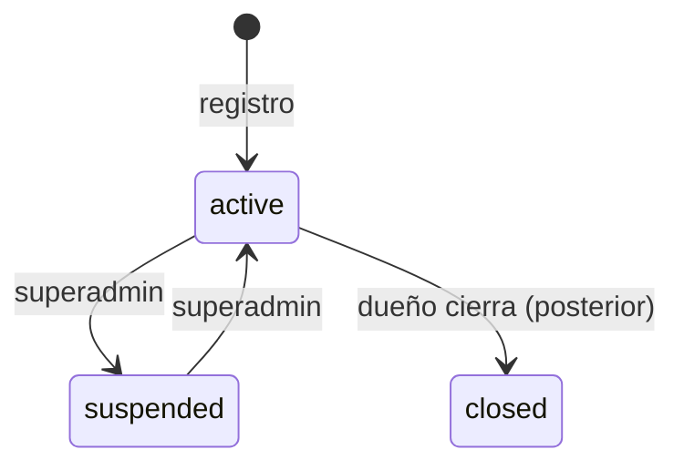

# Autenticación y negocio

## 0. Ficha

| | |
|---|---|
| Fase backend | B1 |
| Features móviles | F1 (hecha, se conecta), F17, F18 |
| Depende de | B0 (fundación), [roles](roles.md), [sucursales](sucursales.md) |
| Estado | Hecho en backend (2026-10-06; login con correo y contraseña desde el commit `e0097db`); app pendiente (F17, F18) |

## 1. Objetivo

Que una persona cree su cuenta con correo y contraseña, registre su negocio
en 4 pasos y quede lista para vender; y que pueda entrar, cambiar de negocio o
sucursal y cerrar sesión de forma segura, **sin depender de servicios de
terceros** para la identidad.

## 2. Alcance v1

- Registro y login con **correo y contraseña propios del backend** (scrypt).
  Sin Firebase Auth, SMS ni Google.
- Bloqueo temporal por intentos fallidos.
- Cambiar la contraseña; contraseña temporal puesta por el superadmin (y por
  el dueño a su personal en B8) que obliga a cambiarla.
- Refresh token rotativo con detección de reuso; cierre de sesión.
- `/me`: datos del usuario y sus membresías (negocios, rol, permisos,
  sucursales permitidas).
- Registro del negocio (pasos 3 y 4 del mockup) en **una sola transacción**.
- Editar perfil del negocio (nombre, tipo, departamento, logo, NIT).
- Ajustes del negocio (`business_settings`).
- Registro de dispositivos para push.

## 3. Fuera de alcance

- Varios dueños por negocio (v1: uno). Transferir la propiedad → B8.
- Login con Google, SMS u otros proveedores externos (decisión D3).
- "Olvidé mi contraseña" por correo: requiere un servidor de correo; por ahora
  la recuperación es con contraseña temporal.
- SSO a un panel web → cuando exista el panel.
- Verificación de identidad del negocio (NIT real con el SIN) → posterior.

## 4. Reglas de negocio

- **AUT-R1** El correo identifica la cuenta: único en la plataforma, se guarda
  sin espacios y en minúsculas (`emailTaken`, `invalidEmail`). El celular es
  opcional y solo de contacto.
- **AUT-R2** Nombre completo: al menos 2 palabras (`fullNameRequired`). Celular
  boliviano: 8 dígitos empezando en 6 o 7, se guarda en E.164 `+591…`
  (`invalidMobileNumber`).
- **AUT-R3** El access token dura 15 min; el refresh 60 días. Cada refresh
  invalida el anterior; reusar uno ya usado revoca toda la familia
  (`refreshTokenReused`).
- **AUT-R4** Un usuario desactivado (`is_active = false`) no puede refrescar ni
  usar la API.
- **AUT-R5** Contraseña de 8 a 128 caracteres con letras y números
  (`passwordTooShort`, `weakPassword`). Se guarda solo el hash scrypt.
- **AUT-R6** Correo inexistente y contraseña mala responden igual
  (`invalidCredentials`). 5 fallos seguidos bloquean la cuenta 15 minutos
  (`accountLocked`, con `retryAfterSeconds`); un login correcto reinicia el
  contador.
- **AUT-R7** Cambiar la contraseña exige la actual (`currentPasswordInvalid`)
  y cierra todas las sesiones del usuario (también los access tokens ya
  emitidos); el dispositivo que la cambió recibe una sesión nueva.
- **AUT-R8** Una contraseña temporal (reset) vale para entrar, pero
  `user.mustChangePassword = true` y la app obliga a cambiarla antes de
  seguir. El reset cierra todas las sesiones del usuario y se audita.
- **NEG-R1** Nombre del negocio ≥ 3 caracteres (`businessNameTooShort`). NIT
  opcional, 5–15 dígitos (`invalidTaxId`).
- **NEG-R2** El slug se genera del nombre (`illimani-store`), único en la
  plataforma; si existe se agrega sufijo. Se puede editar (`slugTaken`).
- **NEG-R3** El registro crea en una transacción: negocio, `business_settings`,
  sucursal principal (con departamento y ciudad del negocio), "Caja 1", los
  métodos de pago elegidos (al menos uno, `paymentMethodRequired`), las
  categorías elegidas (al menos una, `salesCategoryRequired`), los 4 roles desde
  plantillas, la membresía del dueño (`is_owner`, rol Administrador, todas las
  sucursales) y la tienda en línea deshabilitada.
- **NEG-R4** Las categorías sugeridas dependen del tipo de negocio (igual que
  `BusinessType.suggestedCategories` en la app).
- **NEG-R5** Un negocio suspendido no puede usar rutas de negocio
  (`businessSuspended`) y su tienda pública devuelve 404.

## 5. Estados



## 6. Tablas

`users`, `refresh_tokens`, `user_devices`, `businesses`,
`business_settings`, `memberships`. Ver [modelo de datos](../modelo-de-datos.md) §1–§2.

## 7. Endpoints

| Método | Ruta | Permiso | Idempotente | Descripción |
|---|---|---|---|---|
| POST | `/v1/auth/register` | público (10/min) | — | `{displayName, email, password, phone?, device?}` → tokens + `user` + `memberships` (vacío) |
| POST | `/v1/auth/login` | público (10/min) | — | `{email, password, device{installationId, platform, appVersion, fcmToken?}}` → tokens + `user` + `memberships` |
| POST | `/v1/auth/refresh` | público | — | `{refreshToken}` → nuevo par |
| POST | `/v1/auth/sign-out` | sesión | — | Revoca la familia, desactiva el dispositivo |
| GET | `/v1/me` | sesión | — | Usuario (incluye `mustChangePassword`) |
| PATCH | `/v1/me` | sesión | — | Nombre, avatar |
| PUT | `/v1/me/password` | sesión (10/min) | — | `{currentPassword, newPassword}` → sesión nueva; cierra las demás |
| POST | `/v1/admin/users/{id}/reset-password` | `platform.users.manage` | — | → `{temporaryPassword}` (se muestra una vez) |
| GET | `/v1/me/memberships` | sesión | — | `[{business, role, permissions[], branches[], isOwner}]` |
| PUT | `/v1/me/devices/{installationId}` | sesión | sí | Token FCM |
| POST | `/v1/businesses` | sesión | sí | Registro completo (pasos 3 y 4) |
| GET | `/v1/business` | miembro | — | Perfil del negocio activo |
| PATCH | `/v1/business` | `business.update` | — | Nombre, tipo, departamento, logo, NIT, slug |
| GET/PATCH | `/v1/business/settings` | `business.settings` | — | Ajustes |

`POST /v1/businesses` (cuerpo):

```json
{ "id": "uuid", "name": "Illimani Store", "type": "clothing_and_footwear",
  "department": "santa_cruz", "city": "Santa Cruz de la Sierra", "logoFileId": null,
  "taxId": "1020304050", "categoryNames": ["Ropa", "Calzado"],
  "paymentMethods": ["cash", "qr"] }
```

## 8. Errores

| code | HTTP | Cuándo |
|---|---|---|
| `invalidCredentials` | 401 | AUT-R6 |
| `accountLocked` | 423 | AUT-R6 |
| `currentPasswordInvalid` | 422 | AUT-R7 |
| `refreshTokenInvalid` / `refreshTokenReused` | 401 | AUT-R3 |
| `fullNameRequired`, `invalidMobileNumber`, `invalidEmail` | 422 | AUT-R1, AUT-R2 |
| `passwordTooShort`, `weakPassword` | 422 | AUT-R5 |
| `emailTaken` | 409 | AUT-R1 |
| `businessNameTooShort`, `invalidTaxId`, `salesCategoryRequired`, `paymentMethodRequired` | 422 | NEG-R1, NEG-R3 |
| `slugTaken` | 409 | NEG-R2 |
| `businessSuspended` | 403 | NEG-R5 |

## 9. Permisos

`business.update`, `business.settings`. El registro no necesita permiso (crea
el negocio y al usuario como dueño).

## 10. Eventos

`business.created` (seeder de secuencias, tienda en línea), `user.signed_in`
(último acceso). Sin push.

## 11. Concurrencia, idempotencia y auditoría

- `POST /businesses` con id del cliente: reintentar no crea dos negocios.
- El consumo del refresh es un único `UPDATE … WHERE used_at IS NULL AND revoked_at IS NULL RETURNING`.
- El contador de fallos se incrementa con un único `UPDATE … RETURNING`
  (dos intentos simultáneos no se pisan).
- Auditoría: `business.updated` (cambio de NIT o slug), `auth.refresh_reused`,
  `auth.account_locked`, `auth.password_changed`, `auth.password_reset`.

## 12. Impacto en la app POS

- **F18:** `MockAuthRepository` → API. La pantalla de login usa correo y
  contraseña (`POST /auth/login`; ya existe `signInWithEmail`). El paso 1 del
  registro pide nombre, correo, contraseña y celular opcional
  (`POST /auth/register`). Se eliminan el paso del código SMS
  (`phone_verification_screen`), el login por celular y el botón de Google.
- Pantalla "Cambiar contraseña" (desde Más → Cuenta) y obligatoria al entrar
  si `mustChangePassword`.
- Mensajes para `invalidCredentials`, `accountLocked` (con minutos
  restantes), `emailTaken`, `weakPassword`, `currentPasswordInvalid`.
- El paso 4 debe **persistir los métodos de pago** (hoy se validan pero no se
  guardan).
- `SessionRepository` guarda tokens en almacenamiento seguro; restaura sesión
  al abrir la app.
- Después del login: si hay 0 membresías → registro de negocio; si hay 1 →
  entra; si hay varias → selector (F19).
- "Cerrar sesión" (F1) llama a `POST /auth/sign-out`.
- `PATCH /business` reemplaza a `saveBusinessProfile`.

## 13. Impacto en la web

Ninguno en v1 (el cliente web compra sin cuenta). El slug del negocio es la URL
del catálogo.

## 14. Origen en LaCase

- `src/auth/*`: estructura de módulo, decoradores y la idea del login con
  correo y contraseña. bcrypt se cambia por scrypt de `node:crypto` (sin
  dependencia nativa) y se agregan el bloqueo y la contraseña temporal. Se
  reutiliza el patrón de `auth_sso_codes` (hash + consumo atómico) para los
  refresh tokens.
- `src/business/entities/business.entity.ts`, `businesses.service.ts`: se
  adaptan (slug, estado, tipo, NIT).
- `src/user/devices/*`: se adapta.

## 15. Criterios de aceptación

- Dado un correo nuevo, cuando se registra con una contraseña válida, entonces
  se crea el usuario y la respuesta trae 0 membresías.
- Dado un correo ya registrado (con otras mayúsculas), cuando se registra otra
  vez, entonces responde 409 `emailTaken`.
- Dado un usuario, cuando falla la contraseña 5 veces seguidas, entonces
  responde 423 `accountLocked` y ni la contraseña correcta entra hasta que
  pasen 15 minutos.
- Dado un usuario con sesión en dos celulares, cuando cambia la contraseña en
  uno, entonces el otro recibe 401 en la siguiente llamada.
- Dado un reset del superadmin, cuando el usuario entra con la contraseña
  temporal, entonces `mustChangePassword` es `true`.
- Dado un refresh token ya usado, cuando se vuelve a enviar, entonces responde
  401 `refreshTokenReused` y ningún token de esa familia sigue sirviendo.
- Cuando se registra un negocio, entonces existen sucursal principal, "Caja 1",
  métodos de pago, categorías, 4 roles y la membresía del dueño; si algo falla,
  no queda nada creado.
- Dado un negocio suspendido, cuando un miembro llama a `/v1/products`, entonces
  responde 403 `businessSuspended`.

## 16. Preguntas abiertas

- ¿Agregar "olvidé mi contraseña" por correo con un servidor SMTP propio?
  Decidir después del piloto según cuántos resets pida el soporte.
- ¿Bloquear en el servidor las rutas de negocio mientras `mustChangePassword`
  sea `true`? En v1 solo lo obliga la app.
