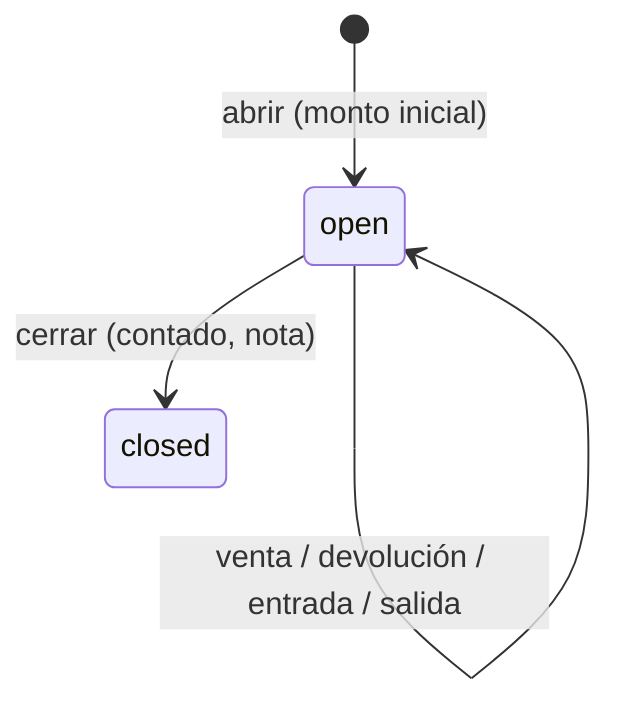

# Caja

## 0. Ficha

| | |
|---|---|
| Fase backend | B4 |
| Features móviles | caja actual (se conecta), F22 |
| Depende de | [sucursales](sucursales.md) (cajas), [métodos de pago](metodos-de-pago.md) |
| Estado | Planificado |

## 1. Objetivo

Controlar el efectivo de cada caja: con cuánto se abre, qué entra y sale
(ventas, devoluciones, gastos, retiros) y cuánto debería haber al cerrar,
comparado con lo contado. **Sin turnos**: abrir y cerrar directamente.

## 2. Alcance v1

- Varias cajas por sucursal; cada una con como máximo una sesión abierta.
- Abrir sesión con monto inicial.
- **Movimientos de efectivo**: entradas (fondo de cambio, otros) y salidas
  (gastos, retiros, pago a proveedor), con motivo, descripción y foto opcional
  del comprobante.
- Resumen en vivo: ventas por método, devoluciones, entradas, salidas,
  efectivo esperado.
- Cierre con monto contado (arqueo), nota, diferencia guardada.
- Cierre "ciego" para quien no tiene `cash.view_expected` (no ve el esperado
  antes de contar).
- Historial de sesiones con su resumen congelado.

## 3. Fuera de alcance

- Turnos dentro de una sesión (existen en LaCase; aquí no).
- Conteo por denominación (billetes y monedas) → posterior.
- Depósitos bancarios y conciliación → posterior.
- Reabrir una sesión cerrada → no previsto (se corrige con un movimiento en la
  siguiente).

## 4. Reglas de negocio

- **CAJ-R1** Una caja tiene como máximo una sesión abierta
  (`cashSessionAlreadyOpen`), garantizado por índice único parcial.
- **CAJ-R2** Monto inicial ≥ 0 (`negativeOpeningAmount`); contado ≥ 0
  (`negativeCountedCash`).
- **CAJ-R3** Para vender hace falta una sesión abierta en la caja elegida
  (`cashSessionRequired`), salvo que `allow_sale_without_session` esté
  activado.
- **CAJ-R4 Efectivo esperado** = monto inicial
  + Σ pagos de ventas `is_cash` de la sesión (neto del cambio)
  − Σ devoluciones en efectivo hechas en la sesión
  + Σ entradas − Σ salidas.
  Las ventas anuladas no cuentan. Los demás métodos se informan pero no suman.
- **CAJ-R5** Una salida no puede dejar el efectivo esperado por debajo de 0
  (`insufficientCash`).
- **CAJ-R6** Al cerrar se calculan y guardan `expected_amount`, `difference =
  counted − expected` y `close_snapshot` (totales por método, cantidad de
  ventas, devoluciones, entradas y salidas). La sesión cerrada no cambia.
- **CAJ-R7** Cualquier usuario con `cash.close` en la sucursal puede cerrar una
  sesión abierta por otro; se guarda quién abrió y quién cerró.
- **CAJ-R8** Una venta solo se puede anular mientras su sesión siga abierta
  (ver [ventas](ventas.md) VEN-R8).
- **CAJ-R9** Un pago a proveedor "desde caja" crea automáticamente una salida
  con motivo `supplier_payment` (ver [compras](compras.md)).
- **CAJ-R10** Un usuario puede tener sesiones abiertas en cajas distintas de
  sucursales distintas, pero la app trabaja con una caja activa a la vez.

## 5. Estados



## 6. Tablas

`cash_registers`, `cash_sessions`, `cash_movements`. Ver
[modelo de datos](../modelo-de-datos.md) §6.

## 7. Endpoints

| Método | Ruta | Permiso | Idempotente | Descripción |
|---|---|---|---|---|
| GET | `/v1/cash-registers/{id}/current-session` | `cash.open` | — | Sesión abierta o `null` |
| POST | `/v1/cash-sessions` | `cash.open` | sí | `{id, cashRegisterId, openingAmount}` |
| GET | `/v1/cash-sessions/{id}/summary` | `cash.close` | — | Resumen en vivo; `expectedAmount` solo con `cash.view_expected` |
| POST | `/v1/cash-sessions/{id}/movements` | `cash.movement` | sí | Multipart: `{id, type, amount, reason, description, photo?}` |
| GET | `/v1/cash-sessions/{id}/movements` | `cash.movement` | — | |
| POST | `/v1/cash-sessions/{id}/close` | `cash.close` | sí | `{countedAmount, note?}` → sesión con esperado y diferencia |
| GET | `/v1/cash-sessions?registerId&from&to&status` | `cash.view_all_sessions` | — | Historial de la sucursal |
| GET | `/v1/cash-sessions/{id}` | `cash.view_all_sessions` o quien la abrió | — | Detalle con snapshot |

`summary` (respuesta):

```json
{ "session": { "id": "…", "openedAt": "…", "openingAmount": 200, "openedBy": "Carla Mamani" },
  "sales": { "count": 18, "byMethod": [{"methodId": "…", "name": "Efectivo", "isCash": true, "amount": 1430}] },
  "refunds": { "count": 1, "byMethod": [ ] },
  "cashIn": 100, "cashOut": 50, "expectedAmount": 1680 }
```

## 8. Errores

`cashSessionAlreadyOpen`, `cashSessionNotOpen`, `cashSessionRequired`,
`negativeOpeningAmount`, `negativeCountedCash` (contrato actual de la app);
`cashRegisterInactive`, `insufficientCash` (409).

## 9. Permisos

`cash.open`, `cash.close`, `cash.movement`, `cash.view_expected`,
`cash.view_all_sessions`.

## 10. Eventos

`cash_session.closed` con diferencia distinta de 0 → notificación al dueño o
encargado (push).

## 11. Concurrencia y auditoría

- Abrir: el índice único parcial evita dos sesiones abiertas aunque lleguen dos
  peticiones a la vez.
- Cerrar: `SELECT … FOR UPDATE` en la sesión; las ventas que llegan durante el
  cierre esperan y luego fallan con `cashSessionNotOpen`.
- Auditoría: cierres con diferencia, salidas de efectivo.

## 12. Impacto en la app POS

- `CashSession` gana `cashRegisterId`, `openedBy` y `closedBy` (ids y nombres),
  `expectedAmount` y `difference`.
- F22: selector de caja al abrir; pantalla de entradas y salidas (motivo,
  monto, foto); cierre ciego sin permiso; historial de cierres.
- El cálculo del esperado pasa al servidor (`GetCashCloseSummary` → `summary`).
- La venta envía `cashSessionId`.

## 13. Impacto en la web

Ninguno.

## 14. Origen en LaCase

- `src/pos/entities/pos-session.entity.ts` y `pos_sessions/*`: apertura, cierre,
  totales, esperado (se quitan los turnos y el estado `closing_control`).
- `src/pos/entities/pos-cash-movements.entity.ts` y `pos_cash_movements/*`:
  movimientos con foto (se quitan `shift_id` y `reservation_id`; se agrega
  `reason`).
- No se copian `pos_shifts`, `branches_shifts`, `PosSetting`.

## 15. Criterios de aceptación

- Dada una sesión abierta con Bs 200, una venta en efectivo de Bs 150 con
  cambio sobre Bs 200 recibidos, una venta QR de Bs 80, una salida de Bs 50 y
  una devolución en efectivo de Bs 30, el esperado es 200 + 150 − 30 − 50 = Bs
  270.
- Dos peticiones simultáneas para abrir la misma caja crean una sola sesión;
  la otra responde `cashSessionAlreadyOpen`.
- Un cajero sin `cash.view_expected` cierra sin ver el esperado; la respuesta
  del cierre sí trae la diferencia.

## 16. Preguntas abiertas

- ¿Mostrar la diferencia al cajero después del cierre ciego? Propuesta: sí.
