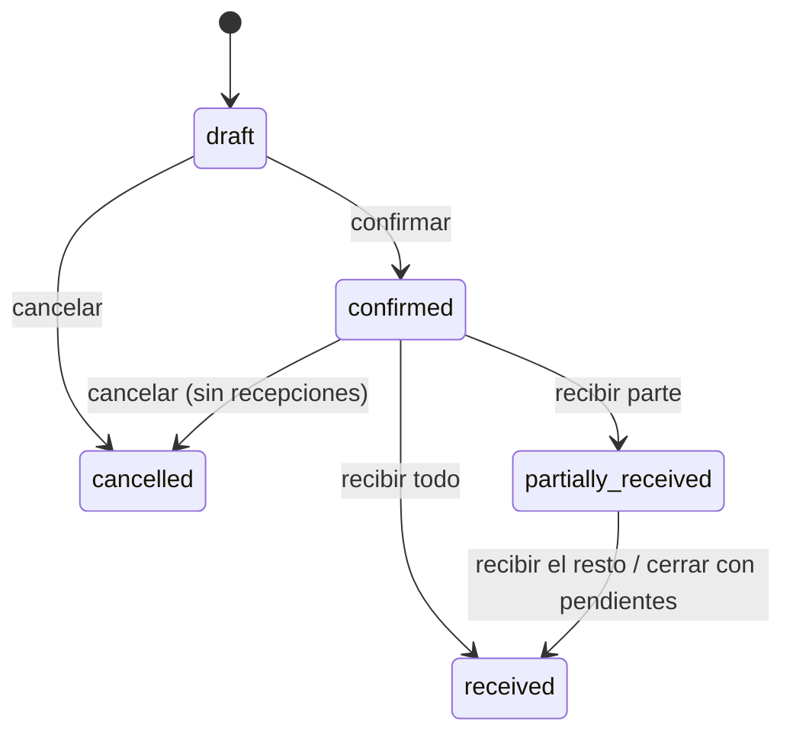

# Compras y proveedores

## 0. Ficha

| | |
|---|---|
| Fase backend | B9 |
| Features móviles | F25 (nueva) |
| Depende de | [productos](productos.md), [inventario](inventario.md), [caja](caja.md), [métodos de pago](metodos-de-pago.md) |
| Estado | Planificado |

## 1. Objetivo

Registrar lo que el negocio compra a sus proveedores: pedirlo (orden de
compra), recibirlo (aunque llegue en partes), pagarlo (al contado o a crédito) y
que el stock y el costo de los productos se actualicen solos.

## 2. Alcance v1

- Proveedores: nombre, NIT, contacto, celular, email, dirección, nota.
- **Orden de compra** (OC-0001) con sucursal destino, proveedor, líneas
  (variante, cantidad, costo unitario, descuento), descuento e impuesto
  globales, fechas esperada y de vencimiento.
- Estados: borrador → confirmada → parcialmente recibida → recibida, o
  cancelada.
- **Recepciones parciales**: cada recepción ingresa stock en la sucursal
  destino y actualiza el costo.
- **Pagos a proveedor**: varios abonos; estado de pago (sin pagar, parcial,
  pagado); "pagar desde caja" genera una salida de efectivo.
- Cuentas por pagar: OCs con saldo, por proveedor y vencimiento.
- Compartir la OC por WhatsApp al proveedor (texto o PDF generado en la app).

## 3. Fuera de alcance

- Devoluciones a proveedor → posterior.
- Facturas de proveedor y crédito fiscal → con facturación.
- Lista de reposición automática desde stock mínimo → B10 (F16).
- Compras en otra moneda → no previsto.

## 4. Reglas de negocio

- **COM-R1** Solo se editan órdenes en borrador. Al confirmar se congelan
  líneas y totales (`invalidPurchaseTransition`).
- **COM-R2** Total = Σ (cantidad × costo − descuento de línea) − descuento
  global + impuesto. Todo en centavos.
- **COM-R3** Se recibe solo una OC confirmada o parcialmente recibida, en su
  sucursal destino (`purchase.receive` en esa sucursal). Por línea, recibido
  acumulado ≤ pedido (`receiveQuantityExceeded`).
- **COM-R4** Cada línea recibida genera un movimiento `purchase` con
  `unit_cost` efectivo (costo de la línea con descuentos prorrateados) y
  `source = purchase_receipt`.
- **COM-R5 Costo** según `business_settings.cost_update_mode`:
  `last` → el costo de la variante pasa a ser el último costo;
  `average` → promedio ponderado con el stock total del negocio
  ((stock × costo actual + cantidad × costo nuevo) ÷ (stock + cantidad));
  `manual` → no cambia.
- **COM-R6** Cuando todo está recibido, la OC pasa a `received`. Si se cancela
  una OC parcialmente recibida, lo recibido se queda y lo pendiente se cierra
  (estado `received`, con nota "cerrada con pendientes"); una OC sin
  recepciones pasa a `cancelled`.
- **COM-R7** Pagos: Σ pagos ≤ total (`paymentExceedsDue`); se pueden registrar
  desde la confirmación (anticipo). `payment_status` se recalcula en cada pago.
- **COM-R8** Un pago con un método `is_cash` y la opción "desde caja" exige una
  sesión abierta en la caja elegida y crea una salida `supplier_payment`
  (`cashSessionNotOpen`, `insufficientCash`).
- **COM-R9** Proveedor con nombre único en el negocio (`supplierNameTaken`); no
  se borra si tiene OCs (se desactiva).

## 5. Estados

Estado de pago independiente: `unpaid → partial → paid`.

## 6. Tablas

`suppliers`, `purchase_orders`, `purchase_order_lines`, `purchase_receipts`,
`purchase_receipt_lines`, `purchase_payments`. Ver
[modelo de datos](../modelo-de-datos.md) §9.

## 7. Endpoints

| Método | Ruta | Permiso | Idempotente | Descripción |
|---|---|---|---|---|
| GET/POST | `/v1/suppliers` | `purchase.view` / `supplier.manage` | sí (POST) | |
| PATCH | `/v1/suppliers/{id}` | `supplier.manage` | — | |
| GET | `/v1/purchase-orders?status&paymentStatus&supplierId&branchId&from&to` | `purchase.view` | — | |
| POST | `/v1/purchase-orders` | `purchase.create` | sí | Borrador con líneas |
| PUT | `/v1/purchase-orders/{id}` | `purchase.create` | — | Editar borrador |
| POST | `/v1/purchase-orders/{id}/confirm` | `purchase.confirm` | sí | |
| POST | `/v1/purchase-orders/{id}/receipts` | `purchase.receive` | sí | `{id, lines: [{orderLineId, quantity}], note}` |
| POST | `/v1/purchase-orders/{id}/cancel` | `purchase.cancel` | sí | `{reason}` |
| POST | `/v1/purchase-orders/{id}/payments` | `purchase.pay` | sí | `{id, paymentMethodId, amount, reference?, fromCashSessionId?}` |
| GET | `/v1/purchase-orders/{id}` | `purchase.view` | — | Con recepciones y pagos |
| GET | `/v1/payables?supplierId&dueBefore` | `purchase.view` | — | Saldos pendientes |

## 8. Errores

`supplierNotFound`, `purchaseOrderNotFound` (404); `supplierNameTaken`,
`invalidPurchaseTransition`, `receiveQuantityExceeded`, `paymentExceedsDue`,
`cashSessionNotOpen`, `insufficientCash` (409); `emptyGoodsReceipt` (422).

## 9. Permisos

`supplier.manage`, `purchase.view`, `purchase.create`, `purchase.confirm`,
`purchase.receive`, `purchase.pay`, `purchase.cancel`.

## 10. Eventos

`purchase.received` → notificación al encargado de la sucursal destino.
Vencimientos próximos → recordatorio (B10).

## 11. Concurrencia, idempotencia y auditoría

- Recepción: `FOR UPDATE` en la OC; `quantity_received` con condición en el
  `UPDATE`; stock por `StockService`; costo en la misma transacción.
- Numeración `OC-0001` con `document_sequences` (LaCase usa `MAX()+1`).
- Auditoría: confirmaciones, cancelaciones, pagos.

## 12. Impacto en la app POS

F25 (nuevo): Más → Compras: proveedores, lista de OCs con filtros, formulario
(buscar o escanear productos), confirmar, recibir (cantidades por línea),
pagos, compartir por WhatsApp. El "Ingreso de mercadería" de F3 se mantiene
para compras rápidas sin OC; su campo "proveedor" pasa a ser un selector de
proveedores.

## 13. Impacto en la web

Ninguno.

## 14. Origen en LaCase

`src/purchase/*` casi completo: entidades (`Supplier`, `PurchaseOrder`,
`PurchaseOrderLine`, `PurchasePayment`), servicios y DTOs,
`purchase-order-number.constant.ts`, y `receivePurchaseStock` con modos de
costo (`products-branches.service.ts`). Cambios: líneas por `variant_id`,
recepciones parciales (LaCase recibe todo de una vez), pagos con métodos del
negocio en lugar del enum fijo, secuencias sin `MAX()+1`.

## 15. Criterios de aceptación

- OC de 10 unidades a Bs 20: recibir 6 deja la OC `partially_received`, +6 en
  stock y, en modo `last`, costo 20; recibir 5 más responde
  `receiveQuantityExceeded`.
- En modo `average`, con 10 unidades a Bs 10 en stock, recibir 10 a Bs 20 deja
  el costo en Bs 15.
- Un pago de Bs 50 desde caja crea una salida de Bs 50 en esa sesión y baja el
  esperado.

## 16. Preguntas abiertas

- ¿El costo promedio se calcula con el stock de todo el negocio o de la sucursal
  destino? Propuesta: negocio, porque el costo es único por variante.
