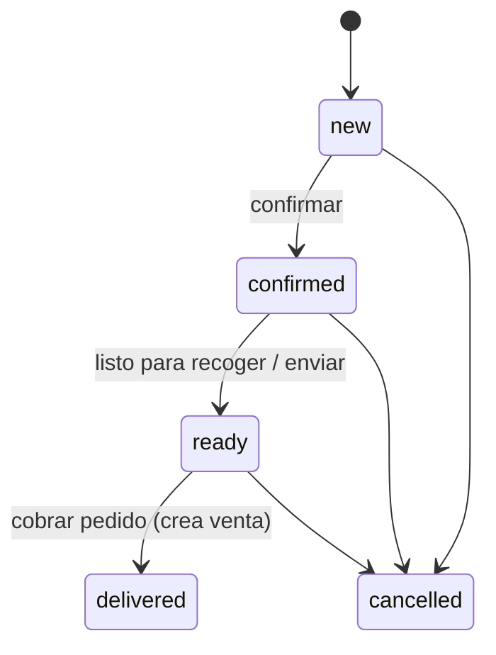

# Ecommerce y pedidos

## 0. Ficha

| | |
|---|---|
| Fase backend | B7 |
| Features móviles | F11, F12 (F13 queda reemplazada), F26 |
| Depende de | [productos](productos.md), [inventario](inventario.md), [sucursales](sucursales.md), [métodos de pago](metodos-de-pago.md), [ventas](ventas.md), [clientes](clientes.md), [notificaciones](archivos-y-notificaciones.md) |
| Estado | Planificado |

## 1. Objetivo

Que cada negocio tenga un link público (`/<slug>`) con su catálogo, donde
cualquiera haga un pedido sin cuenta, y que ese pedido **llegue al POS** de la
sucursal correcta, se gestione por estados y se cobre como una venta. Es la
base de la página de negocio del futuro marketplace.

## 2. Alcance v1

**Configuración (POS)**

- Habilitar o deshabilitar la tienda en línea.
- Datos públicos: frase, banner, WhatsApp, nota de envío.
- Qué sucursales venden en línea; en cuáles se puede recoger; cuál despacha los
  envíos.
- Horario por sucursal; aceptar o no pedidos fuera de horario.
- Mostrar o no los productos agotados.
- Visibilidad en línea por producto (`show_online`).
- Link y póster QR imprimible ("Escanea y pide").

**API pública (web)**

- Tienda, sucursales en línea, categorías, productos y producto por slug, con
  stock de la sucursal elegida.
- Crear pedido; consultar estado con un token.

**Bandeja de pedidos (POS)**

- Pedidos de la sucursal en tiempo real (socket + push).
- Estados: nuevo → confirmado → listo → entregado, o cancelado.
- Confirmar o avisar por WhatsApp (link prellenado).
- "Cobrar pedido": crea la venta en la caja abierta, descuenta stock y marca el
  pedido como entregado.

## 3. Fuera de alcance

- Cuenta del comprador, carrito sincronizado, seguir negocios, chat →
  fase 2.
- Pago en línea → posterior.
- Costo de envío calculado por zona → posterior (v1: `delivery_fee` manual al
  confirmar, por defecto 0).
- Reserva de stock al hacer el pedido → posterior.
- Dominio propio por negocio → posterior.

## 4. Reglas de negocio

- **ECO-R1** La tienda responde solo si el negocio está activo y la tienda
  habilitada (`storeDisabled` → 404 en la web).
- **ECO-R2** El catálogo público solo incluye productos activos con
  `show_online`, de categorías no archivadas. **Nunca incluye costo**, stock de
  otras sucursales ni datos internos.
- **ECO-R3** Retiro en tienda: el cliente elige una sucursal con
  `sells_online` y `pickup_enabled`. Envío: lo despacha
  `online_stores.delivery_branch_id`. El stock mostrado y validado es el de esa
  sucursal.
- **ECO-R4** Al crear un pedido, el servidor recalcula precios y total y valida
  stock en la sucursal (`insufficientStock`, `priceChanged` con el detalle para
  que la web actualice el carrito). **No reserva** stock.
- **ECO-R5** Validación del cliente: nombre ≥ 3, celular boliviano, dirección ≥
  5 si es envío, nota ≤ 200, método de pago con `show_online` (mismas reglas
  que `checkout-schema.ts` de la web).
- **ECO-R6** Fuera de horario: si la tienda no acepta pedidos fuera de horario
  → `storeClosed`; si los acepta, el pedido entra y la web avisa cuándo abre.
- **ECO-R7** Numeración por negocio desde 1001. El pedido devuelve un
  `publicToken` para consultar su estado.
- **ECO-R8** Transiciones válidas: new → confirmed | cancelled; confirmed →
  ready | cancelled; ready → delivered | cancelled
  (`invalidOrderTransition`). Cada cambio se guarda en
  `order_status_history`.
- **ECO-R9** **delivered** solo se alcanza con "Cobrar pedido", que crea una
  venta (`channel = online_order`, `order_id`) con las reglas de
  [ventas](ventas.md): sesión de caja abierta, stock disponible, pagos. El
  precio cobrado es el del pedido (no se recalcula), salvo que se edite antes de
  cobrar.
- **ECO-R10** Se puede editar un pedido (cantidades, quitar líneas, costo de
  envío) mientras esté en new o confirmed; los cambios quedan en el historial.
- **ECO-R11** Anti-abuso: rate limit por IP y por celular (ej. 5 pedidos por
  hora); el pedido guarda `ip_hash`. Cloudflare Turnstile cuando haga falta.
- **ECO-R12** El cliente del pedido se crea o reutiliza por celular (ver
  [clientes](clientes.md) CLI-R2).

## 5. Estados

## 6. Tablas

`online_stores`, `orders`, `order_lines`, `order_status_history`; flags en
`branches` y `products.show_online`. Ver
[modelo de datos](../modelo-de-datos.md) §10.

## 7. Endpoints

**Públicos** (`@Public`, rate limit):

| Método | Ruta | Descripción |
|---|---|---|
| GET | `/v1/public/stores` | Directorio (la raíz de la web) |
| GET | `/v1/public/stores/{slug}` | Tienda: datos, sucursales en línea con horario y estado abierto o cerrado, métodos de pago, categorías |
| GET | `/v1/public/stores/{slug}/products?branchId&categoryId&q` | Productos con precio y stock de la sucursal |
| GET | `/v1/public/stores/{slug}/products/{productSlug}?branchId` | Detalle |
| POST | `/v1/public/stores/{slug}/orders` | `{id, branchId, fulfillment, customer{name, phone, address, note}, paymentMethodId, lines[{variantId, quantity, expectedUnitPrice}]}` → `{number, publicToken, total, status}` |
| GET | `/v1/public/orders/{publicToken}` | Estado y resumen del pedido |

**Del negocio:**

| Método | Ruta | Permiso | Descripción |
|---|---|---|---|
| GET/PATCH | `/v1/online-store` | `store.settings` | Configuración |
| GET | `/v1/orders?status&from&to&cursor` | `order.view` | Bandeja de la sucursal |
| GET | `/v1/orders/{id}` | `order.view` | Detalle con historial |
| PATCH | `/v1/orders/{id}` | `order.manage` | Editar (new/confirmed) |
| POST | `/v1/orders/{id}/status` | `order.manage` | `{to: confirmed \| ready \| cancelled, note?}` |
| POST | `/v1/orders/{id}/checkout` | `order.convert` + `sale.create` | `{saleId, cashSessionId, payments[]}` → venta |

## 8. Errores

`storeDisabled`, `orderNotFound` (404); `storeClosed`, `invalidOrderTransition`,
`insufficientStock`, `priceChanged` (409); `validationFailed`,
`invalidMobileNumber` (422); `cashSessionRequired` al cobrar.

## 9. Permisos

`store.settings`, `order.view`, `order.manage`, `order.convert`.

## 10. Eventos y notificaciones

- `order.created` → socket a `branch:{id}` + push a los miembros con
  `order.view` en esa sucursal ("Nuevo pedido #1024 · Bs 450").
- `order.updated` → socket (bandeja de otros dispositivos).
- Para el cliente sin cuenta: la página `/pedido/<token>` muestra el estado; el
  negocio avisa por WhatsApp. (Push al comprador → fase 2.)

## 11. Concurrencia e idempotencia

- El pedido usa el `id` generado por la web: reintentos no duplican pedidos.
- Cambios de estado con `FOR UPDATE`.
- "Cobrar" es idempotente por `saleId`; `UNIQUE(sales.order_id)` impide dos
  ventas para un pedido.

## 12. Impacto en la app POS

- F11: pantalla "Tienda en línea" (configuración, link, póster QR, switch
  "Mostrar en línea" por producto, horarios por sucursal).
- F12: bandeja "Pedidos" (lista por estado, detalle, botones de estado,
  WhatsApp, "Cobrar pedido" que abre el checkout con las líneas cargadas).
- F26: registro FCM, socket, badge de pedidos nuevos en Inicio.
- F13 (importar por link) queda reemplazada: solo se haría si la API se
  retrasa.

## 13. Impacto en la web

- `catalogRepository()` y `orderRepository()` pasan a implementaciones HTTP.
- **Se quita `output: 'export'`** (`apps/web/next.config.ts`): ISR o SSR para
  SEO y vistas previas de WhatsApp actualizadas; hosting con runtime de Next
  (Netlify Next runtime o un servidor Node).
- `Store` cambia: horarios y dirección por sucursal; métodos de pago con datos o
  QR; selector de sucursal en el checkout (retiro) o sucursal de envío por
  defecto.
- `ProductVariant` gana `price`; los ids son uuid.
- El carrito guarda `variantId` (uuid). Antes de enviar, la web maneja
  `priceChanged` e `insufficientStock` mostrando qué cambió.
- La confirmación usa `/pedido/confirmado?t=<publicToken>` y lee el estado del
  servidor. El mensaje de WhatsApp pasa a ser opcional e incluye el número del
  pedido.

## 14. Origen en LaCase

No hay equivalente (LaCase no tiene ecommerce). Se reutilizan: el throttler de
`pos_table_status` (ruta pública con límite), el gateway de websocket y la
estrategia de notificaciones.

## 15. Criterios de aceptación

- La respuesta pública de productos nunca contiene `cost`, `costPrice` ni
  `unitCost` (test igual a `catalog.test.ts` de la web).
- Un pedido para recoger en la sucursal B con 3 unidades, cuando B tiene 2,
  responde `insufficientStock`.
- Cuando entra un pedido, los cajeros de esa sucursal lo ven en la bandeja en
  menos de 2 s sin recargar.
- "Cobrar pedido" sin caja abierta responde `cashSessionRequired`; con caja
  abierta, crea la venta, descuenta stock y el pedido queda `delivered`.
- Reenviar el mismo pedido (mismo `id`) no crea un segundo pedido.

## 16. Preguntas abiertas

- ¿Reservar stock al confirmar el pedido? Propuesta: no en v1; medir pedidos
  cancelados por falta de stock.
- ¿Pedir OTP por SMS al cliente web para evitar pedidos falsos? Propuesta: solo
  si aparece abuso.
