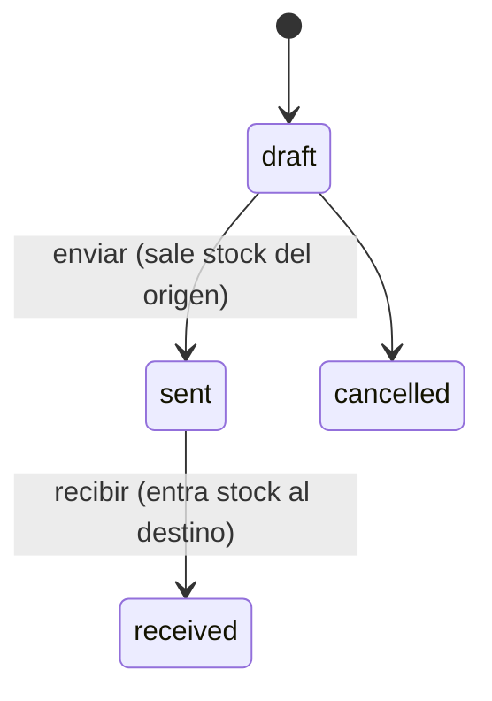

# Inventario

## 0. Ficha

| | |
|---|---|
| Fase backend | B3 (stock, movimientos, transferencias), B10 (conteos, alertas) |
| Features móviles | F3 (hecha, se conecta), F16, F24 |
| Depende de | [productos](productos.md), [sucursales](sucursales.md) |
| Estado | Planificado |

## 1. Objetivo

Saber cuántas unidades hay de cada variante en cada sucursal, y que **todo
cambio de stock tenga un registro** con motivo, persona y documento de origen.

## 2. Alcance v1

- Stock por sucursal y variante (`branch_stock`).
- Libro de movimientos inmutable (`stock_movements`).
- Ingreso de mercadería sin orden de compra (varias líneas, costo opcional,
  proveedor o nota), como F3.
- Ajustes: agregar, quitar o contar (la app calcula la diferencia), con motivo.
- Historial con filtros (producto, variante, tipo, fechas, sucursal).
- Ver el stock de otras sucursales (con permiso).
- **Transferencias entre sucursales** en dos pasos (enviar y recibir).
- Stock mínimo por variante y sucursal (B10).

## 3. Fuera de alcance

- Conteos de inventario con documento (`inventory_counts`) → B10.
- Lotes, vencimientos y números de serie → posterior (veterinarias y
  farmacias lo pedirán).
- Reserva de stock para pedidos → posterior.
- Stock negativo permitido → no previsto.

## 4. Reglas de negocio

- **INV-R1** El stock nunca baja de 0 (`insufficientStock`, con
  `details: [{variantId, available, requested}]`).
- **INV-R2** El único camino para cambiar stock es `StockService.apply`; todo
  cambio crea un movimiento con `stock_after`.
- **INV-R3** Un lote de movimientos se aplica completo o no se aplica.
- **INV-R4** Tipos: `initial`, `purchase`, `adjustment`, `sale`,
  `cancellation`, `return`, `transfer_out`, `transfer_in`. Los ajustes exigen
  motivo: `count`, `damage`, `loss`, `other`, `variant_removed`
  (`adjustmentReasonRequired`).
- **INV-R5** Un ajuste con diferencia 0 se rechaza (`noStockChange`); cantidades
  enteras > 0 (`invalidStockQuantity`); ingreso vacío → `emptyGoodsReceipt`.
- **INV-R6** El ingreso sin orden de compra puede actualizar el costo de la
  variante si se indica `unitCost` (según `cost_update_mode`).
- **INV-R7** Transferencia: al **enviar** sale el stock del origen
  (`transfer_out`); al **recibir** entra en el destino lo recibido
  (`transfer_in`). La diferencia entre enviado y recibido no genera otro
  movimiento: queda en la línea (`quantity_sent` − `quantity_received`) como
  faltante en tránsito, visible en el detalle y en reportes. Origen ≠ destino
  (`transferSameBranch`).
- **INV-R8** Se puede cancelar una transferencia solo en borrador; una enviada
  se recibe (aunque sea con 0).
- **INV-R9** El nombre del producto y el label de la variante se copian en el
  movimiento (el historial no cambia si se renombra).

## 5. Estados de transferencia

## 6. Tablas

`branch_stock`, `stock_movements`, `stock_batches`, `stock_transfers`,
`stock_transfer_lines` (B10: `inventory_counts`, `inventory_count_lines`). Ver
[modelo de datos](../modelo-de-datos.md) §4.

## 7. Endpoints

| Método | Ruta | Permiso | Idempotente | Descripción |
|---|---|---|---|---|
| POST | `/v1/stock-movements` | `stock.receive` o `stock.adjust` | sí | Lote: `{kind: receipt \| adjustment, supplierId?, note?, lines: [{id, variantId, delta \| countedQuantity, reason?, unitCost?}]}` |
| GET | `/v1/stock-movements?productId&variantId&type&from&to&cursor` | `stock.movements_view` | — | Historial de la sucursal |
| GET | `/v1/stock?variantIds=` | `stock.view_all_branches` | — | Stock por sucursal de esas variantes |
| POST | `/v1/stock-transfers` | `stock.transfer_send` | sí | Crear borrador `{toBranchId, lines, note}` |
| POST | `/v1/stock-transfers/{id}/send` | `stock.transfer_send` | sí | Enviar |
| POST | `/v1/stock-transfers/{id}/receive` | `stock.transfer_receive` (en destino) | sí | `{lines: [{variantId, quantityReceived}]}` |
| POST | `/v1/stock-transfers/{id}/cancel` | `stock.transfer_send` | — | |
| GET | `/v1/stock-transfers?status&direction=in\|out` | `stock.movements_view` | — | |
| PATCH | `/v1/stock/{variantId}/min` | `stock.adjust` | — | Stock mínimo (B10) |

Las ventas, devoluciones y compras **no** usan estos endpoints: generan sus
movimientos internamente.

## 8. Errores

`insufficientStock`, `noStockChange`, `invalidStockQuantity`,
`adjustmentReasonRequired`, `emptyGoodsReceipt` (contrato de F3);
`transferSameBranch`, `invalidTransferTransition` (409); `variantNotFound`
(404).

## 9. Permisos

`stock.receive`, `stock.adjust`, `stock.movements_view`,
`stock.view_all_branches`, `stock.transfer_send`, `stock.transfer_receive`.

## 10. Eventos

`stock.changed` (B10: alerta cuando una variante baja de su mínimo →
notificación al encargado). Transferencia enviada → notificación a la sucursal
destino.

## 11. Concurrencia, idempotencia y auditoría

- `UPDATE … SET quantity = quantity + delta WHERE quantity + delta >= 0`, con
  líneas ordenadas por `variant_id` (ver
  [arquitectura](../arquitectura-backend.md) §8).
- Cada línea lleva un id del cliente: reintentar no duplica movimientos.
- Los ajustes (`stock.adjust`) se auditan.

## 12. Impacto en la app POS

- F3 se conecta: `InventoryRepository.recordMovements` → `POST /stock-movements`.
- F24: el stock mostrado es el de la sucursal activa; el detalle del producto
  muestra "Otras sucursales"; nuevas pantallas de transferencias (enviar,
  recibir, lista).
- `StockMovement.userName` viene del servidor.

## 13. Impacto en la web

El stock mostrado es el de la sucursal elegida para el pedido (ver
[ecommerce](ecommerce.md)).

## 14. Origen en LaCase

- `src/product/products_branches/services/products-branches.service.ts`:
  `applyStockDelta` y `adjustStock` (UPDATE atómico) → `StockService`.
- `src/inventory/adjustments/*` → referencia para `inventory_counts` (B10).
- No se copia `pos-stock.service.ts` (descuento diferido al cerrar sesión): en
  Cumavi el stock se descuenta en el momento.

## 15. Criterios de aceptación

- Dadas 2 unidades, cuando dos ventas simultáneas piden 2 cada una, entonces
  una se completa y la otra responde `insufficientStock`; el stock queda en 0,
  nunca en −2.
- Cuando se aplica un lote de 3 líneas y la tercera no tiene stock, entonces
  ninguna línea se aplica.
- Una transferencia de 10 enviada y recibida con 9 deja: −10 en el origen, +9
  en el destino, y la transferencia muestra un faltante de 1.
- El mismo lote enviado dos veces con el mismo `Idempotency-Key` crea los
  movimientos una sola vez.

## 16. Preguntas abiertas

- ¿Recibir una transferencia con faltante exige motivo? Propuesta: nota
  opcional.
