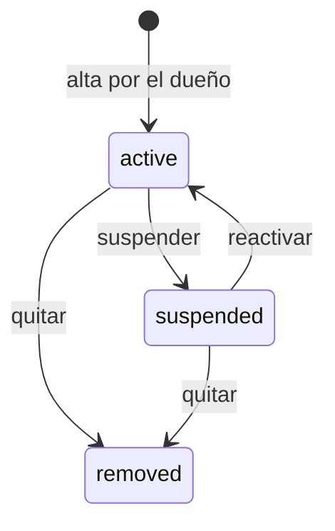

# Usuarios (equipo del negocio)

## 0. Ficha

| | |
|---|---|
| Fase backend | B1 (membresía del dueño, guards), B8 (equipo completo) |
| Features móviles | F14, F19 |
| Depende de | [auth y negocio](auth-y-negocio.md), [roles](roles.md), [sucursales](sucursales.md) |
| Estado | Membresías y `/me/memberships` hechos (2026-10-06); alta de empleados, PIN y gestión en B8 |

## 1. Objetivo

Que el dueño sume a su equipo (encargados, cajeros, almacén), defina qué puede
hacer cada uno y en qué sucursales, y que cada venta, caja y movimiento quede
asociado a la persona que lo hizo.

## 2. Alcance v1

- Una sola tabla `users` para toda la plataforma; la relación con el negocio es
  la **membresía** (rol + sucursales permitidas).
- **El dueño crea la cuenta del empleado**: nombre, correo, contraseña temporal,
  rol y sucursales. Si el correo ya tiene cuenta en Cumavi, solo se agrega la
  membresía (su contraseña no cambia). Sin invitaciones ni links.
- Cambiar rol y sucursales, suspender, reactivar y quitar miembros.
- **Resetear la contraseña** de un empleado (contraseña temporal), porque no
  hay recuperación por correo.
- PIN de 4–6 dígitos para cambio rápido de usuario en un celular compartido.
- Un usuario puede ser miembro de varios negocios.

## 3. Fuera de alcance

- Varios dueños o transferir la propiedad → posterior.
- Horarios o comisiones de vendedores → posterior.
- Invitaciones con aceptación por parte del empleado → no previsto (el dueño
  crea la cuenta).

## 4. Reglas de negocio

- **USR-R1** Un usuario tiene como máximo una membresía por negocio
  (`businessAlreadyRegistered` si ya es miembro).
- **USR-R2** El dueño (`is_owner`) tiene todos los permisos y sucursales, no se
  puede suspender ni quitar (`lastOwnerCannotLeave`), y su rol no se puede
  cambiar.
- **USR-R3** Alta de empleado: si el correo no existe se crea la cuenta con la
  contraseña temporal que muestra la app una sola vez (o una que escribe el
  dueño) y `must_change_password = true`; si existe, se agrega la membresía
  sin tocar su cuenta. El dueño entrega correo y contraseña en persona o por
  WhatsApp.
- **USR-R4** `all_branches = true` da acceso a todas las sucursales, incluidas
  las futuras; si no, solo a las de `membership_branches` (al menos una).
- **USR-R5** Suspender o quitar a un miembro corta su acceso de inmediato (se
  invalida el cache de permisos y se cierran sus sockets). Lo que hizo queda en
  el historial con su nombre.
- **USR-R6** El PIN se guarda con hash (scrypt, igual que las contraseñas) y
  solo sirve para cambiar de usuario dentro de un dispositivo que ya tiene una
  sesión del mismo negocio. 5 intentos fallidos lo bloquean 15 minutos.
- **USR-R7** Toda venta, sesión de caja y movimiento guarda `user_id` y una copia
  del nombre (`cashier_name`), para que el historial no cambie si el usuario
  cambia de nombre.
- **USR-R8** El dueño solo puede resetear la contraseña de cuentas que
  **solo** son miembros de su negocio; si la persona trabaja en otro negocio,
  el reset lo hace el superadmin (evita que un negocio tome la cuenta de
  alguien de otro). El reset cierra todas sus sesiones y se audita.

## 5. Estados

## 6. Tablas

`memberships`, `membership_branches`, `users`. Ver
[modelo de datos](../modelo-de-datos.md) §2.

## 7. Endpoints

| Método | Ruta | Permiso | Descripción |
|---|---|---|---|
| GET | `/v1/members` | `member.view` | Lista con rol, sucursales y estado |
| POST | `/v1/members` | `member.invite` | `{displayName, email, password?, roleId, allBranches, branchIds[]}` → miembro + `temporaryPassword` si se creó la cuenta |
| PATCH | `/v1/members/{id}` | `member.update` | Rol, sucursales, suspender o reactivar |
| DELETE | `/v1/members/{id}` | `member.remove` | Quitar |
| POST | `/v1/members/{id}/reset-password` | `member.update` | → `{temporaryPassword}` (USR-R8) |
| PUT | `/v1/me/memberships/{id}/pin` | sesión | Definir o cambiar mi PIN |
| POST | `/v1/auth/pin-switch` | sesión | `{membershipId, pin}` → tokens de ese usuario |

## 8. Errores

`notAMember` (403), `businessAlreadyRegistered` (409), `lastOwnerCannotLeave`
(409), `invalidEmail` (422), `weakPassword` (422), `permissionDenied` (403).

## 9. Permisos

`member.view`, `member.invite` (alta de empleados), `member.update`,
`member.remove`.

## 10. Eventos

`membership.updated` (invalida cache, desconecta sockets).

## 11. Auditoría

`member.created`, `member.role_changed`, `member.suspended`, `member.removed`,
`auth.password_reset`, `auth.pin_failed`.

## 12. Impacto en la app POS

- **F14:** pantalla "Equipo" en Más: lista, agregar empleado (formulario con
  correo y rol; muestra la contraseña temporal para copiarla o compartirla por
  WhatsApp), editar rol y sucursales, resetear contraseña.
- Cambio rápido de usuario con PIN desde el avatar.
- La app oculta acciones según los permisos de `/me/memberships`; el servidor
  las valida igual.
- Los campos `cashierName` y `userName` ahora vienen del servidor.

## 13. Impacto en la web

Ninguno.

## 14. Origen en LaCase

`src/user/profiles/*` (perfil usuario × sucursal) se reemplaza por membresías
usuario × negocio con varias sucursales. `ProfileGuard` inspira a
`TenantGuard` y `BranchGuard`.

## 15. Criterios de aceptación

- Cuando el dueño agrega `cajero@tienda.bo` (correo nuevo), entonces se crea la
  cuenta, la respuesta trae la contraseña temporal y al entrar con ella
  `mustChangePassword` es `true`.
- Dado un correo que ya tiene cuenta, cuando el dueño lo agrega, entonces solo
  se crea la membresía y su contraseña sigue igual.
- Dado un miembro suspendido, cuando hace cualquier llamada con
  `x-business-id`, entonces responde 403 `notAMember` en menos de 60 s.
- Cuando el dueño intenta quitarse a sí mismo, entonces responde 409
  `lastOwnerCannotLeave`.

## 16. Preguntas abiertas

- ¿El cajero puede ver las ventas de otros cajeros de su sucursal? Propuesta:
  solo con `sale.view_all`.
