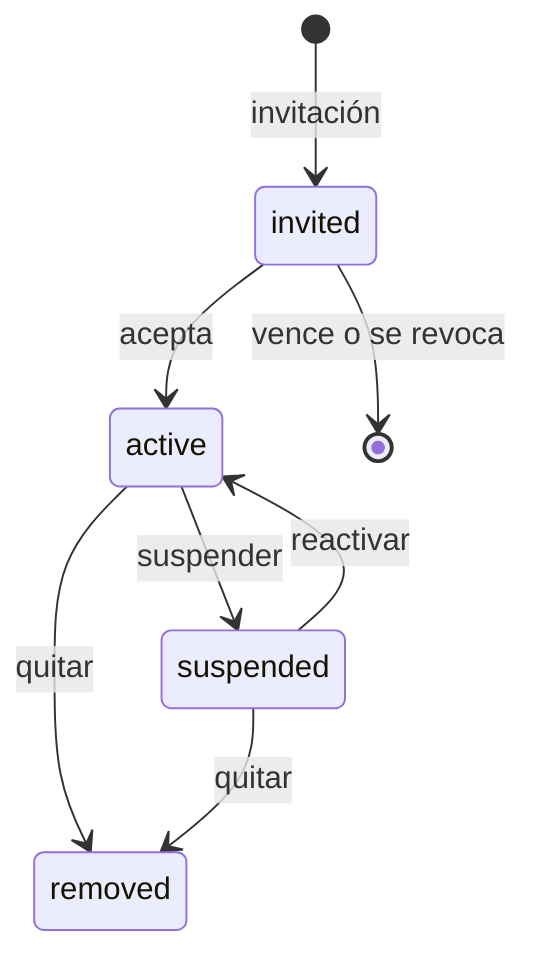

# Usuarios (equipo del negocio)

## 0. Ficha

| | |
|---|---|
| Fase backend | B1 (membresía del dueño, guards), B8 (equipo completo) |
| Features móviles | F14, F19 |
| Depende de | [auth y negocio](auth-y-negocio.md), [roles](roles.md), [sucursales](sucursales.md) |
| Estado | Membresías y `/me/memberships` hechos (2026-10-06); invitaciones, PIN y gestión en B8 |

## 1. Objetivo

Que el dueño sume a su equipo (encargados, cajeros, almacén), defina qué puede
hacer cada uno y en qué sucursales, y que cada venta, caja y movimiento quede
asociado a la persona que lo hizo.

## 2. Alcance v1

- Una sola tabla `users` para toda la plataforma; la relación con el negocio es
  la **membresía** (rol + sucursales permitidas).
- Invitar por número de celular; la persona acepta al entrar con ese celular.
- Cambiar rol y sucursales, suspender, reactivar y quitar miembros.
- PIN de 4–6 dígitos para cambio rápido de usuario en un celular compartido.
- Un usuario puede ser miembro de varios negocios.

## 3. Fuera de alcance

- Varios dueños o transferir la propiedad → posterior.
- Horarios o comisiones de vendedores → posterior.
- Invitación por email → posterior.

## 4. Reglas de negocio

- **USR-R1** Un usuario tiene como máximo una membresía por negocio.
- **USR-R2** El dueño (`is_owner`) tiene todos los permisos y sucursales, no se
  puede suspender ni quitar (`lastOwnerCannotLeave`), y su rol no se puede
  cambiar.
- **USR-R3** Una invitación vale 7 días (`invitationExpired`) y se acepta solo
  con el celular invitado (verificado por Firebase). Reinvitar reemplaza la
  pendiente.
- **USR-R4** `all_branches = true` da acceso a todas las sucursales, incluidas
  las futuras; si no, solo a las de `membership_branches` (al menos una).
- **USR-R5** Suspender o quitar a un miembro corta su acceso de inmediato (se
  invalida el cache de permisos y se cierran sus sockets). Lo que hizo queda en
  el historial con su nombre.
- **USR-R6** El PIN se guarda con hash (bcrypt) y solo sirve para cambiar de
  usuario dentro de un dispositivo que ya tiene una sesión del mismo negocio. 5
  intentos fallidos lo bloquean 15 minutos.
- **USR-R7** Toda venta, sesión de caja y movimiento guarda `user_id` y una copia
  del nombre (`cashier_name`), para que el historial no cambie si el usuario
  cambia de nombre.

## 5. Estados

## 6. Tablas

`memberships`, `membership_branches`, `membership_invitations`, `users`. Ver
[modelo de datos](../modelo-de-datos.md) §2.

## 7. Endpoints

| Método | Ruta | Permiso | Descripción |
|---|---|---|---|
| GET | `/v1/members` | `member.view` | Lista con rol, sucursales y estado |
| POST | `/v1/members/invitations` | `member.invite` | `{phone, roleId, allBranches, branchIds[]}` |
| GET | `/v1/members/invitations` | `member.view` | Pendientes |
| DELETE | `/v1/members/invitations/{id}` | `member.invite` | Revocar |
| GET | `/v1/me/invitations` | sesión | Invitaciones para mi celular |
| POST | `/v1/me/invitations/{id}/accept` | sesión | Crea la membresía |
| PATCH | `/v1/members/{id}` | `member.update` | Rol, sucursales, suspender o reactivar |
| DELETE | `/v1/members/{id}` | `member.remove` | Quitar |
| PUT | `/v1/me/memberships/{id}/pin` | sesión | Definir o cambiar mi PIN |
| POST | `/v1/auth/pin-switch` | sesión | `{membershipId, pin}` → tokens de ese usuario |

## 8. Errores

`notAMember` (403), `invitationExpired` (409), `lastOwnerCannotLeave` (409),
`invalidMobileNumber` (422), `permissionDenied` (403).

## 9. Permisos

`member.view`, `member.invite`, `member.update`, `member.remove`.

## 10. Eventos

`membership.updated` (invalida cache, desconecta sockets), `invitation.created`
(SMS o WhatsApp con link de la app, posterior; en v1 el dueño comparte el link
por WhatsApp).

## 11. Auditoría

`member.invited`, `member.role_changed`, `member.suspended`, `member.removed`,
`auth.pin_failed`.

## 12. Impacto en la app POS

- **F14:** pantalla "Equipo" en Más: lista, invitar (compartir link por
  WhatsApp), editar rol y sucursales.
- Cambio rápido de usuario con PIN desde el avatar.
- La app oculta acciones según los permisos de `/me/memberships`; el servidor
  las valida igual.
- Los campos `cashierName` y `userName` ahora vienen del servidor.

## 13. Impacto en la web

Ninguno.

## 14. Origen en LaCase

`src/user/profiles/*` (perfil usuario × sucursal) se reemplaza por membresías
usuario × negocio con varias sucursales. `ProfileGuard` inspira a
`TenantGuard` y `BranchGuard`.

## 15. Criterios de aceptación

- Dada una invitación al 76543210, cuando entra un usuario con ese celular y la
  acepta, entonces queda como miembro con el rol y las sucursales invitadas.
- Dado un miembro suspendido, cuando hace cualquier llamada con
  `x-business-id`, entonces responde 403 `notAMember` en menos de 60 s.
- Cuando el dueño intenta quitarse a sí mismo, entonces responde 409
  `lastOwnerCannotLeave`.

## 16. Preguntas abiertas

- ¿El cajero puede ver las ventas de otros cajeros de su sucursal? Propuesta:
  solo con `sale.view_all`.
