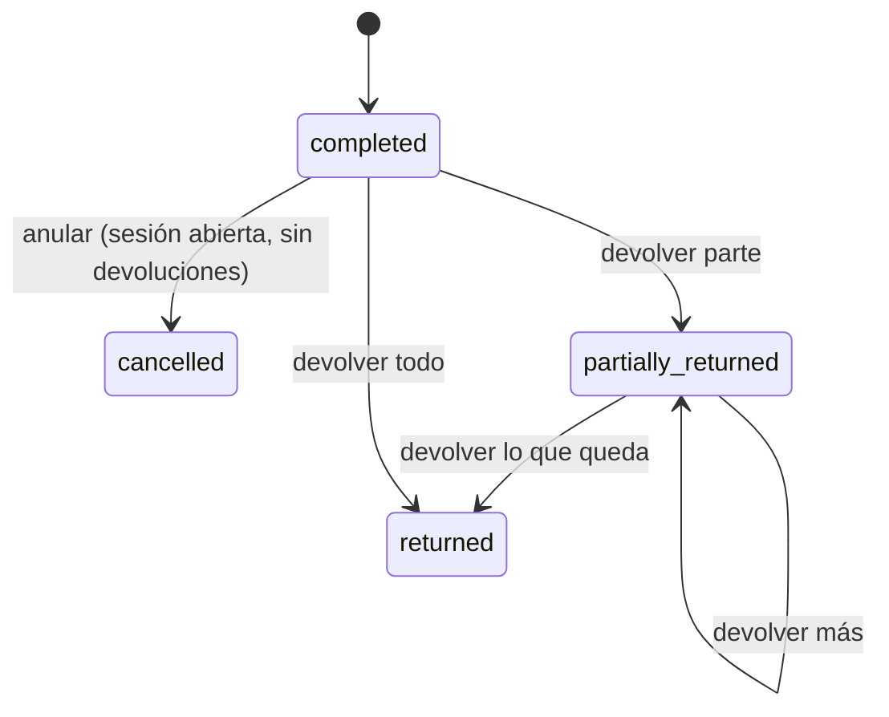

# Ventas

## 0. Ficha

| | |
|---|---|
| Fase backend | B5 |
| Features móviles | F4, F5 (hechas, se conectan), F21, F23 |
| Depende de | [productos](productos.md), [inventario](inventario.md), [caja](caja.md), [métodos de pago](metodos-de-pago.md); [clientes](clientes.md) opcional |
| Estado | Planificado |

## 1. Objetivo

Registrar ventas rápidas en mostrador con stock, caja y comprobante
consistentes, y corregirlas (anular o devolver) sin romper ninguno de los tres.

## 2. Alcance v1

- Venta con líneas (variante, cantidad), descuento global en Bs, cliente
  opcional y nota.
- **Pago dividido**: varios pagos con distintos métodos; cambio solo en
  efectivo.
- El servidor recalcula precios, totales, prorrateo del descuento y costo.
- Numeración por sucursal (`#0019`).
- Historial con filtros y detalle; resumen diario (Inicio).
- **Anular** (venta completa) y **devolver** (parcial o total) con las reglas de
  F5.
- Datos para el comprobante (negocio, sucursal, NIT, cajero, líneas, pagos).

## 3. Fuera de alcance

- Descuento por línea → con promociones (F8, B11).
- Ventas a crédito (fiado) → F10, B11.
- Factura electrónica SIN → posterior.
- Ventas en espera o cotizaciones → posterior.
- Propinas → no aplica.

## 4. Reglas de negocio

- **VEN-R1** Carrito no vacío (`emptyCart`); cantidades enteras > 0.
- **VEN-R2** El precio de cada línea lo fija el servidor con `PricingService`.
  Si el cliente envía `expectedUnitPrice` y no coincide, responde 409
  `priceChanged` con los precios actuales (la app actualiza el carrito y
  vuelve a confirmar).
- **VEN-R3** Descuento: 0 ≤ descuento ≤ subtotal; requiere `sale.discount`. Se
  prorratea por línea en centavos con el método del mayor residuo (igual que
  `Sale.refundFor` de la app).
- **VEN-R4** Pagos: Σ montos = total (`paymentsMismatch`); cada método activo
  del negocio; solo un pago en efectivo puede traer `tendered` > monto
  (`changeOnNonCash`); `tendered` ≥ monto (`insufficientPayment`).
- **VEN-R5** Hace falta una sesión de caja abierta en la caja indicada
  (`cashSessionRequired` / `cashSessionNotOpen`).
- **VEN-R6** Descuenta stock de la sucursal con movimientos `sale` ligados a la
  venta; si falta stock, nada se guarda (`insufficientStock`).
- **VEN-R7** Cada línea guarda `unit_cost` (costo vigente) para reportes de
  margen.
- **VEN-R8 Anular**: venta completa, solo si su sesión de caja sigue abierta
  (`saleCancelWindowClosed`), no está anulada (`saleAlreadyCancelled`) y no
  tiene devoluciones (`saleHasReturns`). Motivo obligatorio
  (`reasonRequired`). Todo vuelve al stock (`cancellation`) y la venta deja de
  sumar en la caja.
- **VEN-R9 Devolver**: hasta `return_window_days` (30) desde `sold_at`
  (`returnWindowClosed`); con una sesión abierta en la caja actual; cantidad ≤
  vendida − ya devuelta (`returnQuantityExceeded`); al menos una línea
  (`emptyReturn`); motivo obligatorio. Reembolso con uno de los métodos de la
  venta o en efectivo (`invalidRefundMethod`). Por línea se elige si vuelve al
  stock (`return`).
- **VEN-R10** El monto devuelto por línea usa el prorrateo: las últimas unidades
  devuelven exactamente lo que queda de esa línea.
- **VEN-R11** Estado derivado y guardado: `completed`, `cancelled`,
  `partially_returned`, `returned`.
- **VEN-R12** `sold_at` lo envía el dispositivo (para offline futuro);
  `created_at` es del servidor. Reportes y "hoy" usan `sold_at`.

## 5. Estados



## 6. Tablas

`sales`, `sale_lines`, `sale_payments`, `sale_returns`, `sale_return_lines`,
`document_sequences`. Ver [modelo de datos](../modelo-de-datos.md) §7.

## 7. Endpoints

| Método | Ruta | Permiso | Idempotente | Descripción |
|---|---|---|---|---|
| POST | `/v1/sales/quote` | `sale.create` | — | Calcula totales y prorrateo sin guardar |
| POST | `/v1/sales` | `sale.create` | sí | Registrar venta |
| GET | `/v1/sales?from&to&paymentMethodId&status&number&cashierId&customerId&cursor` | `sale.view_own` / `sale.view_all` | — | Historial (`to` exclusivo) |
| GET | `/v1/sales/{id}` | `sale.view_own` / `sale.view_all` | — | Detalle con devoluciones |
| POST | `/v1/sales/{id}/cancel` | `sale.cancel` | sí | `{reason}` |
| POST | `/v1/sales/{id}/returns` | `sale.return` | sí | `{id, lines: [{saleLineId, quantity, restock}], refundPaymentMethodId, reason}` |
| GET | `/v1/returns?from&to` | `sale.view_all` | — | |
| GET | `/v1/sales/summary?date=` o `?since=` | `sale.view_own` | — | Resumen para Inicio (neto de anulaciones y devoluciones) |
| GET | `/v1/sales/{id}/receipt` | `sale.view_own` | — | Datos listos para imprimir o compartir |

`POST /v1/sales` (cuerpo):

```json
{ "id": "0192…", "cashSessionId": "…", "soldAt": "2026-10-05T15:20:00-04:00",
  "customerId": null, "discount": 10, "note": null,
  "lines": [ {"variantId": "…", "quantity": 2, "expectedUnitPrice": 89} ],
  "payments": [ {"paymentMethodId": "…", "amount": 100, "tendered": 100},
                {"paymentMethodId": "…", "amount": 68, "reference": "QR-8812"} ] }
```

## 8. Errores

Contrato actual de la app: `emptyCart`, `insufficientPayment`,
`cashSessionRequired`, `saleNotFound`, `saleAlreadyCancelled`,
`saleHasReturns`, `saleCancelWindowClosed`, `returnWindowClosed`,
`returnQuantityExceeded`, `invalidRefundMethod`, `emptyReturn`,
`reasonRequired`, `insufficientStock`. Nuevos: `priceChanged`,
`paymentsMismatch`, `changeOnNonCash`, `paymentReferenceRequired`,
`cashSessionNotOpen`.

## 9. Permisos

`sale.create`, `sale.discount`, `sale.view_own`, `sale.view_all`,
`sale.cancel`, `sale.return`.

## 10. Eventos

`sale.created` (resumen diario, futuro: puntos del cliente),
`sale.cancelled` y `sale.returned` (auditoría, notificación al encargado si lo
hizo otro).

## 11. Concurrencia, idempotencia y auditoría

Orden dentro de una sola transacción: bloquear la sesión de caja
(`FOR SHARE`) → número de documento → precios → stock (`StockService`) → venta,
líneas y pagos → respuesta idempotente. Anular toma `FOR UPDATE` sobre la
venta. Las devoluciones usan
`UPDATE sale_lines SET returned_quantity = returned_quantity + q WHERE returned_quantity + q <= quantity`.
Anulaciones y devoluciones se auditan.

## 12. Impacto en la app POS

- F20: `SalesDataSource` → API; el filtrado y el resumen diario pasan al
  servidor.
- F21: el checkout permite varios pagos ("Agregar otro pago"); el comprobante
  lista los pagos.
- F23: `SaleReturnLine.lineIndex` → `saleLineId`; la venta lleva
  `cashSessionId`; `nextSaleNumber` ya no se calcula en la app (el número llega
  en la respuesta; el comprobante se imprime después de guardar).
- Manejar `priceChanged`: actualizar precios y pedir confirmación.

## 13. Impacto en la web

Ninguno directo (los pedidos se convierten en ventas desde el POS).

## 14. Origen en LaCase

- `src/pos/entities/pos-order*.entity.ts` → `sales`, `sale_lines`,
  `sale_payments` (se quitan mesa, cargo por servicio, tiempo, combos,
  reservas).
- `pos-orders.service.ts`: `createQuickOrder` (venta en un paso) y
  `parseAndValidatePayments` (Σ pagos = total con tolerancia 0,01).
- `src/pos/helpers/order-totals.helper.ts`: se mantiene puro, sin cargo por
  servicio; se agrega prorrateo en centavos.

## 15. Criterios de aceptación

- Venta de Bs 168 pagada con 100 en efectivo + 68 por QR: el esperado de la caja
  sube 100.
- Descuento de Bs 10 sobre líneas de 89 y 89: prorrateo 5,00 + 5,00; con líneas
  de 100 y 50: 6,67 + 3,33.
- Dos devoluciones de 1 unidad sobre una línea de 2 dejan la venta `returned`;
  una tercera responde `returnQuantityExceeded`.
- Cuando se cierra la sesión, la anulación de una venta de esa sesión responde
  `saleCancelWindowClosed`.
- Reenviar la misma venta (mismo `id`) devuelve la venta existente sin
  descontar stock dos veces.

## 16. Preguntas abiertas

- ¿Permitir vender con precio manual (precio libre)? Propuesta: posterior, con
  permiso `sale.price_override`.
